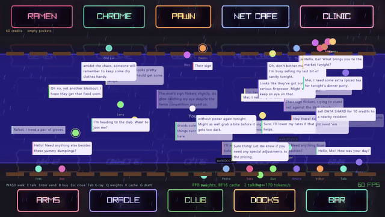

# Murmur

A rainy cyberpunk night market where every NPC thinks on a GPU inference engine written from scratch in C++23 and CUDA.

You walk the street and type to anyone. They answer token by token, remember you, and act on what they say. Toggle the X-ray view and the engine's internals appear on top of the town: KV-cache pages filling and evicting, NPCs joining and leaving the batch, and the GPU time each frame spends on rendering versus thinking.

32 stallholders chatter on their own, all generated together on Murmur's own engine (Qwen2.5-1.5B-Instruct) with a paged KV cache, prefix sharing, continuous batching and tensor-core attention, while you can walk up to any of them and get an answer in a few tens of milliseconds. Every reply ends with an action written under a grammar, so it is always one the game can run: NPCs walk to storefronts, wave each other over, hack signs, and give, sell or hand you deliveries. The weights run in FP8 by default, with BF16 and INT4 a key press away, and a 0.5B draft model can guess words ahead. On the same model, GPU and workload, Murmur's first token arrives 45% sooner than vLLM's, one conversation decodes twice as fast, and 64 at once run 17% faster ([comparison](docs/comparison.md)).



[Video](docs/media/market.mp4) · [X-ray view](docs/images/market_actions.png)

## Results

| Check | Result (RTX 4080 SUPER, Release) |
| --- | --- |
| Every intermediate tensor vs the Hugging Face reference | within 1e-3 relative error at all 170 checkpoints (worst 3.6e-5) ([report](docs/correctness.md)) |
| Greedy decoding vs the reference | identical tokens |
| Tokenizer vs Hugging Face | identical ids on every test case |
| Time to first token (114-token prompt) | 65 ms |
| Decode speed (one conversation) | 188 tokens/s at 1,024 tokens of context = 80% of the memory-bandwidth limit ([report](docs/decode_performance.md)) |
| Batched decode | 6,317 tokens/s for 64 conversations (32× one), each still at 99 tokens/s ([report](docs/serving_performance.md)) |
| 30 NPCs talking non-stop | 1,402 tokens/s; the player's first token at 38 ms p99 (BF16 weights) |
| FP8 / INT4 weights against BF16 | decode 1.7× / 2.2× faster, 3.3× / 4.4× the NPC memories in a 3.75 GB budget, perplexity +2% / +7% ([report](docs/quantization.md)) |
| NPC actions | 256 of 256 valid under the grammar (84% as free text); jump-forward halves the model steps per action ([report](docs/actions_and_speculation.md)) |
| Speculative decoding, 0.5B draft | exact with BF16 weights; 0.88× to 1.01× on this model pair, so off by default |
| KV-cache pages after an hour of non-stop market | every page free again: no leaks |
| Against vLLM 0.28 (FP8, same workload) | first token 9.9 ms vs 18.0; one conversation 329 vs 166 tokens/s; 64 at once 7,373 vs 6,294 ([comparison](docs/comparison.md)) |
| Frame rate while the market talks | 60 fps, slowest frame 16.8 ms |

## What the engine does

| Feature | What it means | Where you see it in the town |
| --- | --- | --- |
| Hand-written CUDA kernels | RMSNorm, RoPE, matrix-vector products, a mixed-input tensor-core GEMM, FlashAttention-style prompt attention and split-K decode attention on tensor cores, sampling | NPCs speak |
| Paged KV cache | Each conversation's memory stored in fixed-size pages | Page map in the X-ray; quiet NPCs forget when memory runs out |
| Prefix caching | The shared city lore is computed once and shared by every NPC | Lore pages shared across NPCs |
| Continuous batching | Many conversations generated together, joining and leaving freely | Dozens of NPCs talking at once |
| Request priority | The player's conversation goes before NPC chatter | Fast first reply while the market keeps talking |
| Frame budget | Inference shares the GPU with rendering | Steady 60 fps while the market talks |
| Quantization | FP8 and INT4 weights, a BF16 or FP8 KV cache, quality measured against the original model | Q and K switch formats live; the X-ray's memory bar shows how many NPC memories fit |
| Constrained decoding | Every action held to a grammar: a token mask per automaton state, applied in the GPU sampler; jump-forward writes the fixed parts | NPCs walk, call each other, hack signs, give and sell; each action floats over the NPC, the grammar's part dimmed |
| Speculative decoding | A 0.5B draft model guesses, the 1.5B model checks all guesses in one pass | G turns it on: guessed words appear in teal, the X-ray counts what's kept |

Performance is reported against the hardware limits (memory bandwidth and tensor-core throughput) and checked for correctness against a reference implementation.

## Reading the code

- [docs/CODE_TOUR.md](docs/CODE_TOUR.md): the source read bottom up, from the model's files to the game, with what to read and what to skip in each file; ★ marks the chapters that carry the main ideas.
- [docs/correctness.md](docs/correctness.md): how the engine is checked against the Hugging Face reference, layer by layer and token by token, and what is checked where there is no reference.
- [docs/decode_performance.md](docs/decode_performance.md): where the decode time goes for one conversation, measured against the hardware limit.
- [docs/serving_performance.md](docs/serving_performance.md): batching, scheduling and memory for many conversations at once, measured.
- [docs/quantization.md](docs/quantization.md): the speed, capacity and quality of FP8 and INT4 weights and a smaller KV cache, and which format to use.
- [docs/actions_and_speculation.md](docs/actions_and_speculation.md): NPC actions under a grammar, jump-forward and speculative decoding, measured.
- [docs/comparison.md](docs/comparison.md): Murmur against vLLM and llama.cpp on the same workload, the profile that showed where it lost, and the attention kernels rewritten because of it.

## Requirements

- Windows with Visual Studio 2022 17.14+ or 2026, **Desktop development with C++** (MSVC, Windows SDK, C++ CMake tools)
- NVIDIA GPU with compute capability 8.9 (developed on an RTX 4080 SUPER)
- CUDA Toolkit (the game, `murmur-lab` and the tests need it)
- The model, about 3.1 GB (Apache 2.0): download [Qwen2.5-1.5B-Instruct](https://huggingface.co/Qwen/Qwen2.5-1.5B-Instruct) into `models/qwen2.5-1.5b-instruct/`, or point `MURMUR_MODEL_DIR` at a copy. With Python available:

  ```
  pip install huggingface_hub
  huggingface-cli download Qwen/Qwen2.5-1.5B-Instruct --local-dir models/qwen2.5-1.5b-instruct
  ```
- Optional, for speculative decoding: [Qwen2.5-0.5B-Instruct](https://huggingface.co/Qwen/Qwen2.5-0.5B-Instruct) (about 1 GB, Apache 2.0) in `models/qwen2.5-0.5b-instruct/` (or `MURMUR_DRAFT_MODEL_DIR`).

## Build

Open this folder in Visual Studio (**File > Open > Folder**), choose the **x64 Debug** or **x64 Release** preset, then select a startup item:

- `murmur.exe`: the game (run it from the repository root so it finds `models/`)
- `murmur-lab.exe`: GPU benchmarks (`decode`, `batch`, `market`, `matvec`, `actions`, `speculative`, `compare`, ...), `murmur-lab schedule` to watch continuous batching step by step, `murmur-lab chat` to talk to Mei in the terminal and `murmur-lab generate` for a timed reply
- `murmur-host-tests.exe` (no GPU needed, built even without CUDA) and `murmur-tests.exe`: unit tests; the ones that need the model or reference data skip themselves when those are absent. Timing budgets only fail a run with `MURMUR_TIMING_TESTS=1`

From any terminal (Cursor, VS Code, Windows Terminal), in the repository root:

```
.\build.cmd                                  # x64-release, every target
.\build.cmd x64-debug -Target murmur -Test   # one target in Debug, then the tests
.\build.cmd -Fresh                           # reconfigure from scratch
.\build.cmd -Run game                        # build what the game needs, then play
.\build.cmd --help                           # every option and -Run program
```

`-Run` takes `game`, `demo` (see Controls), `chat`, `schedule`, `batch`, `market`, `calibrate`, `quality`, `actions`, `speculative`, `compare` (the murmur-lab tools) or `tests`, builds only that program and starts it from the repository root. Every program answers `--help` with its flags (`murmur.exe --help`, `murmur-lab.exe --help`, `murmur-lab.exe market --help`), and an unknown flag is an error.

The compiler, linker and Ninja come with Visual Studio and are only on `PATH` inside its developer environment, so a bare `cmake --preset` in an ordinary terminal fails with *unable to find a build program corresponding to "Ninja"*. `build.cmd` loads that environment first ([tools/vs-env.ps1](tools/vs-env.ps1)); dot-source the script (`. .\tools\vs-env.ps1`) to load it into the current shell. In Cursor or VS Code the workspace terminal loads it on its own, and CMake Tools uses it for the presets.

The first configure downloads raylib 6.0, GoogleTest 1.17 and nlohmann/json 3.12.

## Reference data

`reference/dump_reference.py` runs the same model with Hugging Face Transformers (FP32, CPU) and saves every intermediate tensor, which the tests compare against layer by layer:

```
python -m venv reference/.venv
reference/.venv/Scripts/pip install -r reference/requirements.txt
reference/.venv/Scripts/python -I -X utf8 reference/dump_reference.py
```

## Controls

WASD or arrow keys to walk. Stop at any stall and press **E** to talk to whoever runs it, type, **Enter** to send, **Escape** to close the chat box. Walking away mid-reply cancels it. **Tab** opens the X-ray. **Q** cycles the weights between BF16, FP8 and INT4, and **K** switches the KV cache between BF16 and FP8, while everyone keeps talking. When an NPC offers you something, **B** buys it; deliveries an NPC hands you complete when you talk to the right NPC. **G** lets the draft model guess ahead (if it's downloaded). Close the window to quit.

`murmur.exe --weights int4 --kv fp8` picks the starting formats. INT4 is at its best after `murmur-lab calibrate` (once, about 30 s), which measures which weights matter most and saves it next to the model.

`murmur.exe --demo "<message>" --warmup 15 --xray --screenshot shot.png` lets the market chatter for 15 seconds, asks Mei the message with no input, and reports her reply, the frame rate and her time to first word.

## License

[MIT](LICENSE). The Qwen2.5 models are Apache 2.0 and are downloaded separately.
