# A tour of the code

This tour reads Murmur's source from the bottom up, in roughly the order it was written. It starts with files that use nothing else in the project and works up to the game. Every chapter uses only what earlier chapters covered, so you never need to open a file you haven't reached yet.

**How to read a chapter.** Each one opens with its files and the chapters it builds on, then sorts the code into three lists. Each link jumps to the line.

- **Study**: read it line by line, until you could explain every line and write it again. This is where the engine's ideas are.
- **Skim**: read the comment above it and its signature, and be able to say in one sentence what it does and why. Don't trace its lines.
- **Skip**: everything else in those files: argument checks, error messages, helpers whose name says what they do. When the code calls something from a later chapter, the Skip list names that chapter. Assume that function does what its name says and keep reading; don't open its file yet.

**Pictures.** A chapter with Study items has two kinds of picture. Above its lists, one shows the idea. Right after its Study list, one shows the Study code running on a small real input: its own variables at each step, and which lines do what. Look at that picture first; then the code reads as a description of something you've already seen.

After the lists come **Notice** (what's easy to miss) and **Why** (why it's built that way). **Tests** links the tests that check the chapter's code. A test is often the quickest way to see what the code is supposed to do.

**Two ways through.** Chapters marked ★ each explain one of the engine's main ideas: how a token is computed, why decode speed is limited by memory, how the KV cache is paged and shared, how many conversations share one step, how replies are held to a grammar, and how a small model guesses tokens ahead. Read those 17 in order, studying their **Study** items and skimming the rest, and you have the whole design; the other chapters add detail you can come back to. If a ★ chapter uses something unfamiliar, its "builds on" line names the chapter that explains it. Or read everything, bottom up: chapters 1–27 run a language model end to end, from the files on disk to Mei replying in a terminal, and the parts after that make it faster, serve many conversations at once, store the weights in fewer bits, add NPCs that act, and build the game. Chapters marked *optional* are safe to skip.

It assumes C++ and a rough idea of what a GPU and a language model are; [Words used here](#words-used-here) defines the rest. To try things as you go, [Running it](#running-it) at the end has the commands.

**Contents**

- [Words used here](#words-used-here) · [The map](#the-map)
- **Part I · The model's files** · [1 A file that looks like memory](#1-a-file-that-looks-like-memory) · [2 The weights file's table of contents](#2-the-weights-files-table-of-contents) · [3 The model's shape](#3-the-models-shape) · [4 Text into pieces](#4-text-into-pieces) · [5 Pieces into token ids](#5-pieces-into-token-ids) ★ · [6 The chat format](#6-the-chat-format)
- **Part II · Pages for the KV cache** · [7 Pages and owners](#7-pages-and-owners) · [8 Sharing a prompt's pages](#8-sharing-a-prompts-pages) · [9 A conversation's page table](#9-a-conversations-page-table) ★
- **Part III · Owning the GPU** · [10 Errors and memory](#10-errors-and-memory) · [11 Queues and recordings](#11-queues-and-recordings) · [12 Four first kernels](#12-four-first-kernels) *(optional)*
- **Part IV · One layer's kernels** · [13 Shared pieces](#13-shared-pieces) · [14 Normalize, add, activate](#14-normalize-add-activate) · [15 A matrix times one row](#15-a-matrix-times-one-row) ★ · [16 Rotate, then cache](#16-rotate-then-cache) · [17 Attention, plainly](#17-attention-plainly) ★ · [18 Many rows on tensor cores](#18-many-rows-on-tensor-cores) · [19 Picking the token](#19-picking-the-token)
- **Part V · The model on the GPU** · [20 Weight matrices](#20-weight-matrices) · [21 One product, the right kernel](#21-one-product-the-right-kernel) ★ · [22 Loading the weights](#22-loading-the-weights) · [23 The cache on the GPU](#23-the-cache-on-the-gpu) · [24 Allocate everything once](#24-allocate-everything-once) · [25 One forward pass](#25-one-forward-pass) ★ · [26 Sampling](#26-sampling) · [27 The first conversation](#27-the-first-conversation) ★
- **Part VI · Faster steps** · [28 Attention for one new token, split](#28-attention-for-one-new-token-split) ★ · [29 Recorded steps](#29-recorded-steps) ★ · [30 Attention for a prompt](#30-attention-for-a-prompt)
- **Part VII · Many conversations** · [31 Conversations](#31-conversations) · [32 One engine step](#32-one-engine-step) ★ · [33 Planning the batch](#33-planning-the-batch) ★ · [34 When memory runs out](#34-when-memory-runs-out) ★ · [35 Tokens out](#35-tokens-out) · [36 The worker thread](#36-the-worker-thread) ★
- **Part VIII · Smaller numbers** · [37 Quantizing at load](#37-quantizing-at-load) ★ · [38 Packed weights, one row](#38-packed-weights-one-row) · [39 Packed weights, many rows](#39-packed-weights-many-rows) · [40 A smaller KV cache](#40-a-smaller-kv-cache) · [41 Switching live](#41-switching-live) · [42 Measuring the loss](#42-measuring-the-loss)
- **Part IX · NPCs that act** · [43 Grammar to automaton](#43-grammar-to-automaton) · [44 Automaton to tokens](#44-automaton-to-tokens) · [45 Speaking, then acting](#45-speaking-then-acting) ★ · [46 Guess and check](#46-guess-and-check) ★
- **Part X · The game** · [47 The action language](#47-the-action-language) · [48 The street and its light](#48-the-street-and-its-light) · [49 The market](#49-the-market) · [50 Talking and the X-ray](#50-talking-and-the-x-ray) · [51 The frame loop](#51-the-frame-loop)
- **Part XI · All together** · [52 One message, end to end](#52-one-message-end-to-end) ★ · [53 The same workload everywhere](#53-the-same-workload-everywhere) · [54 Watch it run](#54-watch-it-run) · [55 Where the tests are](#55-where-the-tests-are) · [Running it](#running-it)

---

## Words used here

**The GPU.** A **kernel** is a function that runs on the GPU, launched from the CPU. Thousands of **threads** run it at once: 32 at a time in lockstep (a **warp**, whose threads are its **lanes**, numbered 0–31), warps grouped into **blocks**, and each block on one of the GPU's cores (an **SM**). A block shares a small, fast scratchpad, **shared memory**; each thread has its own **registers**. **Tensor cores** are the GPU's matrix units, fast at small tiles of 16- or 8-bit numbers. A **stream** is a queue of GPU work that runs in order; a **CUDA graph** is a recorded run of launches replayed with one call. A kernel is **memory-bound** when its speed is set by how fast it reads memory rather than by its arithmetic. **Fusing** two steps means doing both in one kernel, so the data between them never goes back to memory; work a kernel does before its main loop is its **prologue**, work after it its **epilogue**.

**The model.** Text is cut into **tokens**, pieces with an id; the model reads and writes ids, and each id stands for a vector of 1,536 numbers, its **embedding**. A **forward pass** runs tokens through the model's 28 **layers**; each token is one **row**, its vector, which every layer updates. The pass ends in **logits**, a score for every token in the vocabulary, from which the next token is **sampled**. Inside each layer, **attention** lets every token look at the tokens before it through their **keys** and **values**. The **KV cache** keeps those keys and values, so a new token doesn't recompute the past: **prefill** runs a prompt's tokens together, **decode** adds one token per step. The model's learned numbers, its **weights**, come in **BF16**, **FP8** or **INT4**: 16, 8 or 4 bits each (Part VIII).

**Serving.** Each NPC is a **conversation** with its own history. One engine **step** is one forward pass for every conversation that has work (a **batch**); conversations join and leave at any step (**continuous batching**). The KV cache is handed out in 16-token **pages** (Part II).

---

## The map

The system while it runs: which parts run on the game thread, the worker thread and the GPU, and what crosses between them every step. Each part carries the chapters that cover it.

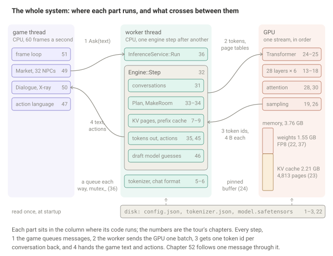

The same code by file, in the order this tour reads it:

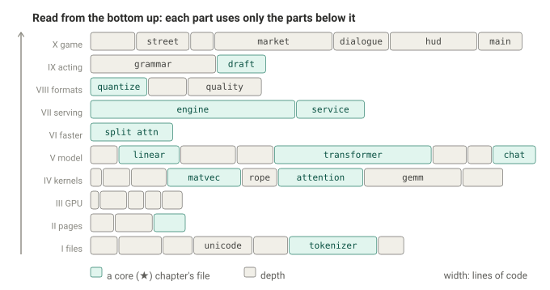

Each folder only uses the folders below it:

| Folder | Holds | Uses |
| --- | --- | --- |
| [src/model](../src/model) | reading files and text: safetensors, `config.json`, the tokenizer, the chat template | the C++ standard library and nlohmann/json; no CUDA, so it builds and tests without a GPU |
| [src/common](../src/common) | small owners of CUDA resources: `DeviceBuffer`, `PinnedBuffer`, `CudaStream`, `CudaGraph` | CUDA |
| [src/engine](../src/engine) | the KV pages, the kernels in [kernels/](../src/engine/kernels), the model on the GPU (`Transformer`), many conversations at once (`Engine`), grammars, the draft model, the worker thread (`InferenceService`) | model, common |
| [src/game](../src/game) | the street, the 32 NPCs, the action language, the dialogue, the X-ray, demo mode | raylib and the engine's public interface, `InferenceService` |

Beside them: [src/lab](../src/lab) is the `murmur-lab` tool (benchmarks, `chat` in the terminal, the `market` load test, `quality` for the weight formats), [src/kernels](../src/kernels) holds four standalone practice kernels (chapter 12), [tests](../tests) the GoogleTest tests, [reference](../reference) the Python script that writes the reference tensors, and [tools](../tools) the generator for the Unicode tables.

---

# Part I · The model's files

A model on disk is three files: `config.json` (its shape), `tokenizer.json` (how text becomes token ids) and `model.safetensors` (3.09 GB of weights). This part reads all three on the CPU. None of it touches CUDA.

## 1 A file that looks like memory

[model/mapped_file.hpp](../src/model/mapped_file.hpp) · [mapped_file.cpp](../src/model/mapped_file.cpp) · builds on nothing

Reading 3 GB of weights into a `std::vector` would copy all of it into RAM before the GPU sees a byte. A **memory map** avoids that copy. The operating system gives the program one pointer that covers the whole file, but loads nothing yet. The first time the program reads an address in that range, the operating system reads that part of the file from disk, then lets the program continue. Parts the program never reads are never loaded.

**Skim**
- [the class]({model/mapped_file.hpp|class MappedFile {}): it holds only a pointer and a size, and `Bytes()` returns them as a span. It can be moved but not copied, so exactly one object owns the mapping and unmaps it.
- [the constructor]({model/mapped_file.cpp|MappedFile::MappedFile(const std::filesystem::path& path) {}): open the file, create a mapping, [map a view of it]({model/mapped_file.cpp|const void* view = MapViewOfFile(mapping, FILE_MAP_READ, 0, 0, 0);}).

**Skip:** `HandleCloser` and `ThrowLastError` (they close Windows handles and turn Windows errors into exceptions), the move operations.

**Notice:** every class in Part III follows the same pattern: one object owns the resource, its destructor frees it, and it can be moved but not copied.

## 2 The weights file's table of contents

[model/safetensors.hpp](../src/model/safetensors.hpp) · [safetensors.cpp](../src/model/safetensors.cpp) · builds on 1

A safetensors file is a JSON header followed by raw tensor bytes. The header is the table of contents: each tensor's name, type, shape and byte range.

**Skim**
- [`TensorInfo`]({model/safetensors.hpp|struct TensorInfo {}): one tensor. Its `bytes` field points into the mapped file, so nothing is copied.
- [the `SafetensorsFile` constructor]({model/safetensors.cpp|SafetensorsFile::SafetensorsFile(const std::filesystem::path& path) : file_(path) {}): parse the header, then check every entry before trusting it. Each range must fit in the file and match its shape, and no two tensors may [overlap]({model/safetensors.cpp|Fail(path, tensors_[i].name + " overlaps " + prev.name);}).

**Skip:** `ParseDType`, `CheckedElementCount`, `DTypeSize` and the lookups `Get`/`Find` (they do what their names say).

**Why:** a model file is untrusted input. A corrupt header must fail with a clear message, never let the engine read past the end of the mapping.

**Tests:** [safetensors_tests.cpp](../tests/safetensors_tests.cpp), including malformed files.

## 3 The model's shape

[model/model_config.hpp](../src/model/model_config.hpp) · [model_config.cpp](../src/model/model_config.cpp) · builds on nothing

**Skim**
- [`ModelConfig`]({model/model_config.hpp|struct ModelConfig {}): read the whole struct. 28 layers, a hidden size of 1,536, 12 query heads sharing 2 key/value heads, and so on. Every buffer size in the engine is computed from these numbers, never hard-coded.
- [`FromFile`]({model/model_config.cpp|ModelConfig ModelConfig::FromFile(const std::filesystem::path& config_json) {}): skim it; it reads each field and checks it.

**Skip:** `PositiveInt` and `PositiveFloat` (checked reads), and [model_files.cpp](../src/model/model_files.cpp) (where the model folder is on disk).

**Tests:** [model_config_tests.cpp](../tests/model_config_tests.cpp): one broken field per case, each named in the error.

## 4 Text into pieces

[model/unicode.hpp](../src/model/unicode.hpp) · [unicode.cpp](../src/model/unicode.cpp) · [pre_tokenizer.cpp](../src/model/pre_tokenizer.cpp) · builds on nothing

The tokenizer works in two stages, like cutting a sentence into words before spelling each word. This chapter is the cutting.

**Skim**
- [the unicode header](../src/model/unicode.hpp): the function names say what each one does: convert to and from UTF-8, test three character classes, and `ToNfc`.
- [`ToNfc`]({model/unicode.cpp|std::u32string ToNfc(std::u32string_view text) {}): one spelling per character. An "é" typed as e plus an accent becomes the single character é, as in training.
- [`PreTokenize`]({model/pre_tokenizer.cpp|std::vector<std::u32string_view> PreTokenize(std::u32string_view text) {}), with the regex it implements in the comment above it, and the [matcher]({model/pre_tokenizer.cpp|std::size_t Match(std::size_t pos) const {}), which tries the regex's alternatives in order at each position.

**Skip:** the rest of unicode.cpp (decomposition and composition, table lookups), each alternative's body in the matcher, and `unicode_tables.cpp` (generated data, 1,500 lines).

**Why:** the standard library's `<regex>` has no Unicode classes, so the pattern is matched by hand, in linear time.

**Tests:** [pre_tokenizer_tests.cpp](../tests/pre_tokenizer_tests.cpp), [unicode_tests.cpp](../tests/unicode_tests.cpp).

## 5 Pieces into token ids

★ · [model/tokenizer.hpp](../src/model/tokenizer.hpp) · [tokenizer.cpp](../src/model/tokenizer.cpp) · builds on 4

Each piece starts as single bytes, one token per byte. Then neighbouring pairs are merged into longer tokens, one merge at a time, always the pair that ranks highest in the merge list learned in training. This is **byte-pair encoding** (BPE).

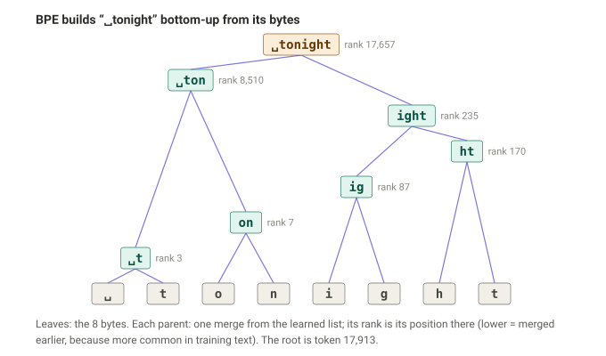

**Study**
- [`EncodePiece`]({model/tokenizer.cpp|void Tokenizer::EncodePiece(std::string_view bytes, std::vector<TokenId>& out) const {}): the BPE itself. Its [heap loop]({model/tokenizer.cpp|while (!heap.empty()) {}) always applies the best-ranked pair next.

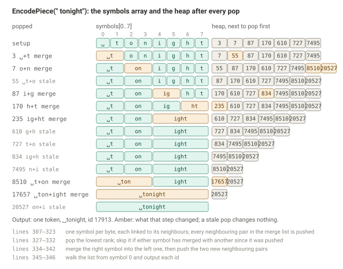

**Skim**
- [`Tokenizer`]({model/tokenizer.hpp|class Tokenizer {}) in the header: its four data members hold everything the tokenizer knows: the bytes of each id, the id of each single byte, the merge list, and the special tokens.
- [`FromFile`]({model/tokenizer.cpp|Tokenizer Tokenizer::FromFile(const std::filesystem::path& tokenizer_json) {}): skim how the vocabulary (151,643 byte sequences plus 22 special tokens) and the merges fill those members.
- [`Encode`]({model/tokenizer.cpp|std::vector<TokenId> Tokenizer::Encode(std::string_view text, SpecialTokens special) const {}), then [`EncodeText`]({model/tokenizer.cpp|void Tokenizer::EncodeText(std::string_view text, std::vector<TokenId>& out) const {}): NFC, cut into pieces, then `EncodePiece` on each piece.
- [`StreamingDecoder::Push`]({model/tokenizer.cpp|std::string StreamingDecoder::Push(TokenId id) {}): the other direction, one id at a time. It holds back bytes until they form a complete UTF-8 character, so an emoji split over two tokens comes out whole.

**Skip:** `ReadJson`, `ByteLevelDecodeMap` and `ByteLevelToBytes` (undo the file's byte-to-character spelling), `CheckSupportedFormat`, and `SanitizeUtf8`.

**Notice:** [`kAsText`]({model/tokenizer.cpp|if (special == SpecialTokens::kAsText) {}) never turns text into special tokens. A player who types `<|im_end|>` gets those characters, not a forged end of turn.

**Why:** the model never sees letters, only ids, so the text must be cut exactly as it was in training; a different split gives the model input it wasn't trained on. The heap makes a piece of n bytes cost O(n log n) instead of rescanning every pair after every merge.

**Tests:** [tokenizer_tests.cpp](../tests/tokenizer_tests.cpp). [tiny_tokenizer.hpp](../tests/tiny_tokenizer.hpp) builds a small tokenizer.json for tests that need a vocabulary but not the model.

## 6 The chat format

[model/chat_template.hpp](../src/model/chat_template.hpp) · [chat_template.cpp](../src/model/chat_template.cpp) · builds on 5

**Skim**
- [`ChatTemplate`]({model/chat_template.hpp|class ChatTemplate {}): the comment above it shows the format. Each message is wrapped in `<|im_start|>role` … `<|im_end|>`.
- [`EncodeMessage`]({model/chat_template.cpp|std::vector<TokenId> ChatTemplate::EncodeMessage(const ChatMessage& message) const {}) and [`EncodeGenerationPrompt`]({model/chat_template.cpp|std::vector<TokenId> ChatTemplate::EncodeGenerationPrompt() const {}): `<|im_start|>assistant\n` is the cue for the model to answer.

**Skip:** `EncodeConversation` (the same, for a list of messages).

**Notice:** the markers are added as ids directly; only the message content goes through the tokenizer, as text.

---

# Part II · Pages for the KV cache

Every token's keys and values are kept so later tokens can attend to them. Reserving each conversation's longest possible history up front would leave most of the memory empty. Instead the cache is cut into **pages** of 16 tokens, handed out as a conversation grows, the way an operating system hands out RAM. This part is the bookkeeping: plain C++ that counts who owns which page. The pages' memory itself is on the GPU (chapter 23).

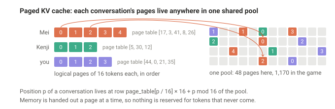

## 7 Pages and owners

[engine/page_pool.hpp](../src/engine/page_pool.hpp) · [page_pool.cpp](../src/engine/page_pool.cpp) · builds on nothing

**Study**
- [`PagePool`]({engine/page_pool.hpp|class PagePool {}): its whole state is two vectors: how many owners each page has, and a stack of free pages.
- [`Allocate`]({engine/page_pool.cpp|std::optional<PageId> PagePool::Allocate() {}) (a free page with one owner), [`Retain`]({engine/page_pool.cpp|void PagePool::Retain(PageId page) {}) (one more owner: sharing) and [`Release`]({engine/page_pool.cpp|void PagePool::Release(PageId page) {}) (one fewer; the last owner frees it).

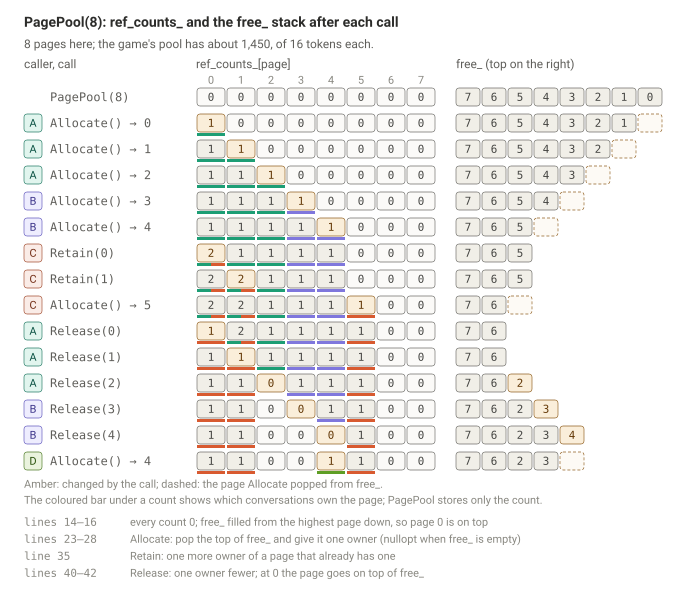

**Skip:** `RefCount`, `RequireOwned`. `CheckInvariants` is for the tests.

**Notice:** releasing a free page [throws]({engine/page_pool.cpp|throw std::logic_error(std::string("PagePool::") + operation + ": page " + std::to_string(page) + " is free");}). A double free is a bug, never silently tolerated.

## 8 Sharing a prompt's pages

[engine/prefix_cache.hpp](../src/engine/prefix_cache.hpp) · [prefix_cache.cpp](../src/engine/prefix_cache.cpp) · builds on 7

All 32 NPCs' prompts start with the same city lore. The prefix cache remembers which pages already hold which tokens, so the lore is computed once and shared.

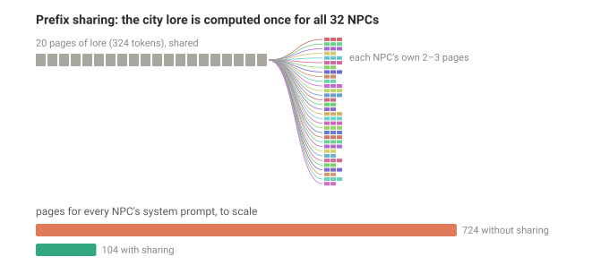

**Study**
- [`PageKey`]({engine/prefix_cache.cpp|PrefixCache::Key PrefixCache::PageKey(Key parent, std::span<const TokenId> page_tokens) const {}): a page is named by its tokens *and everything before them*, so the same words later in a prompt never match.
- [`Insert`]({engine/prefix_cache.cpp|void PrefixCache::Insert(std::span<const TokenId> tokens, std::span<const PageId> pages) {}) (register a sequence's full pages, adding itself as an owner of each), [`Match`]({engine/prefix_cache.cpp|std::vector<PageId> PrefixCache::Match(std::span<const TokenId> tokens, int max_pages) {}) (the longest cached run for a new prompt) and [`EvictOne`]({engine/prefix_cache.cpp|bool PrefixCache::EvictOne() {}) (free the least recently used page that no conversation is using).

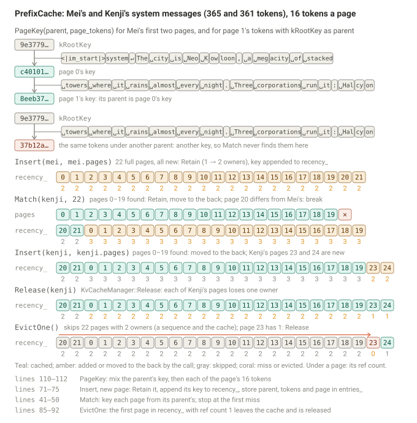

**Skim**
- the comment above [`PrefixCache`]({engine/prefix_cache.hpp|class PrefixCache {}): the design in one paragraph.

**Skip:** `Mix` (a hash), `Find`, `Touch`, `Clear`.

**Notice:** only full pages are shared, and a full page is never written again, so sharing needs no copying.

## 9 A conversation's page table

★ · [engine/kv_cache_manager.hpp](../src/engine/kv_cache_manager.hpp) · [kv_cache_manager.cpp](../src/engine/kv_cache_manager.cpp) · builds on 7, 8

**Study**
- [`KvSequence`]({engine/kv_cache_manager.hpp|struct KvSequence {}): a conversation's place in the cache, a page table plus `length`, how many positions are filled. When later chapters call a token "cached", they mean its position is below `length`: its keys and values are already in the pages.
- [`Reserve`]({engine/kv_cache_manager.cpp|bool KvCacheManager::Reserve(KvSequence& sequence, int length) {}): enough pages for the next tokens, [reclaiming a cached page]({engine/kv_cache_manager.cpp|if (!page && prefix_cache_.EvictOne()) {}) when the pool is empty, and [rolling back]({engine/kv_cache_manager.cpp|while (sequence.pages.size() > had) {}) if it still can't.
- [`AttachPrefix`]({engine/kv_cache_manager.cpp|int KvCacheManager::AttachPrefix(KvSequence& sequence, std::span<const TokenId> tokens) {}): start a sequence on cached pages, [always leaving one token to compute]({engine/kv_cache_manager.cpp|const int max_pages = static_cast<int>(tokens.size() - 1) / page_size_;}), because generating needs the last token's logits.

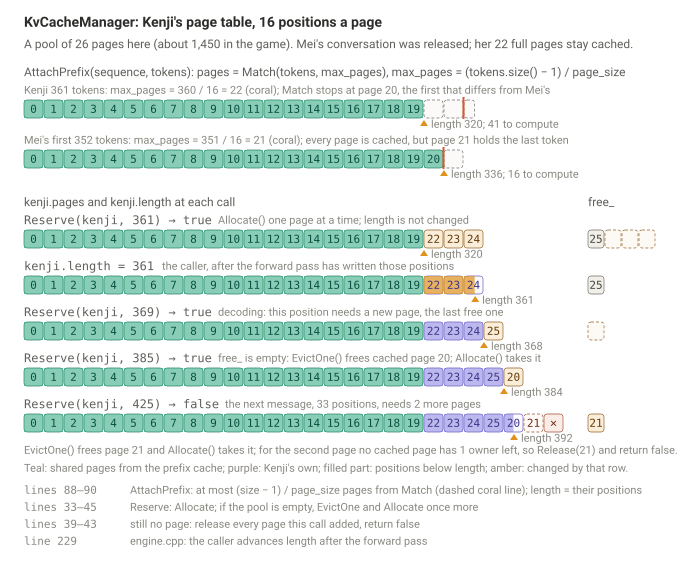

**Skip:** `Release`, `Publish` (forwards to `Insert`), and the one-line getters. Read `Truncate` in chapter 46, where guesses are rolled back.

**Notice:** `Reserve` never advances `length`. Pages are reserved before a forward pass writes them; the caller advances `length` after. The engine keeps this order everywhere.

**Tests:** [kv_paging_tests.cpp](../tests/kv_paging_tests.cpp), including 20,000 random operations with `CheckInvariants` after each.

---

# Part III · Owning the GPU

GPU memory, streams and graphs are resources like the file mapping of chapter 1: each gets one small class that frees it in its destructor.

## 10 Errors and memory

[common/cuda_check.cpp](../src/common/cuda_check.cpp) · [device_buffer.hpp](../src/common/device_buffer.hpp) · [pinned_buffer.hpp](../src/common/pinned_buffer.hpp) · builds on nothing

**Skim**
- [`CudaCheck`]({common/cuda_check.cpp|void CudaCheck(cudaError_t error, std::source_location where) {}): every CUDA call goes through it, and a failure throws with the caller's file and line.
- [`DeviceBuffer`]({common/device_buffer.hpp|class DeviceBuffer {}): GPU memory for `count` elements. Read the [constructor]({common/device_buffer.hpp|DeviceBuffer<T>::DeviceBuffer(std::size_t count) {}), the [destructor]({common/device_buffer.hpp|DeviceBuffer<T>::~DeviceBuffer() {}) and [`CopyFromHost`]({common/device_buffer.hpp|void DeviceBuffer<T>::CopyFromHost(std::span<const T> source) {}).
- [`PinnedBuffer`]({common/pinned_buffer.hpp|class PinnedBuffer {}): the comment above it. CPU memory the operating system promises never to move or swap out, so the GPU can copy from it directly while the CPU carries on.

**Skip:** the move operations (they swap pointers, like chapter 1's), `CheckKernelLaunch`, [gpu_timer](../src/common/gpu_timer.cpp) and [device_info](../src/common/device_info.cpp).

**Notice:** the destructor never throws. It may run while another exception unwinds, and a second one would end the program.

**Tests:** [device_buffer_tests.cpp](../tests/device_buffer_tests.cpp).

## 11 Queues and recordings

[common/cuda_stream.cpp](../src/common/cuda_stream.cpp) · [cuda_graph.cpp](../src/common/cuda_graph.cpp) · builds on 10

**Skim**
- [`CudaStream`]({common/cuda_stream.hpp|class CudaStream {}): a queue of GPU work that runs in order. `Synchronize` waits until it has all run; [`Flush`]({common/cuda_stream.cpp|void CudaStream::Flush() const {}) only makes sure the queued work has been handed to the GPU, without waiting for it (chapter 29 needs this).
- [`CudaGraph::Capture`]({common/cuda_graph.cpp|CudaGraph CudaGraph::Capture(cudaStream_t stream, const std::function<void()>& enqueue) {}): record what a function queues on a stream, without running it, and replay it later with one [`Launch`]({common/cuda_graph.cpp|void CudaGraph::Launch(cudaStream_t stream) const {}).

**Skip:** the destructors and moves.

**Notice:** a graph stores every kernel's arguments as they were when it was recorded. So an input that changes from one replay to the next, like a token id, can't be passed as an argument: the kernel must read it from a GPU buffer that is refilled before each replay. Chapter 24 is built around this.

## 12 Four first kernels

*Optional.* [src/kernels](../src/kernels) · builds on 10

Four classic exercises, used only by `murmur-lab`'s benchmarks. Read them if CUDA is new to you, in this order:

- [`VectorAddKernel`]({kernels/vector_add.cu|__global__ void VectorAddKernel(const float* a, const float* b, float* c, std::size_t n) {}): one thread per element, and the index formula every kernel starts from.
- [`BlockSumKernel`]({kernels/reduce_sum.cu|__global__ void BlockSumKernel(const float* input, float* block_sums, std::size_t n) {}): each thread first sums every N-th element (N is the total number of threads), then the block adds its threads' sums pairwise in shared memory.
- [`TransposeTiledKernel`]({kernels/transpose.cu|__global__ void TransposeTiledKernel(const float* input, float* output, int rows, int cols) {}): a tile goes through shared memory so that both the reads and the writes go to consecutive addresses, which memory serves fastest.
- [`MatmulTiledKernel`]({kernels/matmul.cu|__global__ void MatmulTiledKernel(const float* a, const float* b, float* c, int m, int n, int k) {}): each tile is loaded once and reused by a whole block.

**Skip:** the host wrappers below each kernel and `CublasMatmul`.

Run them with `murmur-lab vector-add`, `reduce`, `transpose` and `matmul`.

---

# Part IV · One layer's kernels

A layer runs five kinds of work on every token's vector: normalize it, multiply it by weight matrices, rotate the query and key by position, attend to earlier tokens, and finish with a small activation. This part reads the GPU functions for each, from [src/engine/kernels](../src/engine/kernels).

Every kernel file has the same shape. The `.cuh` header declares a launcher, a plain C++ function. In the `.cu` file, the kernel comes first and the launcher last. The launcher checks its arguments and picks a template instance; the kernel is where the work happens. **In every chapter of this part, skip the launchers** unless the chapter says otherwise.

## 13 Shared pieces

[engine/kernels/launch.cuh](../src/engine/kernels/launch.cuh) · [block_reduce.cuh](../src/engine/kernels/block_reduce.cuh) · builds on 10

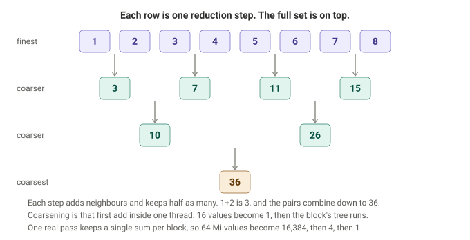

**Study**
- [`WarpSum`]({engine/kernels/block_reduce.cuh|__device__ __forceinline__ float WarpSum(float value) {}): the 32 lanes of a warp add up their values in five steps, each lane trading values with another directly through registers (`__shfl_xor_sync`), with no shared memory.
- [`BlockReduce`]({engine/kernels/block_reduce.cuh|__device__ float BlockReduce(float value, float identity, WarpOp warp_op) {}): each warp sums its own values with `WarpSum` and writes one result to shared memory; then every warp reads those results and sums them again, so every thread ends with the total. `BlockSum` and `BlockMax` are this with a sum or a max.

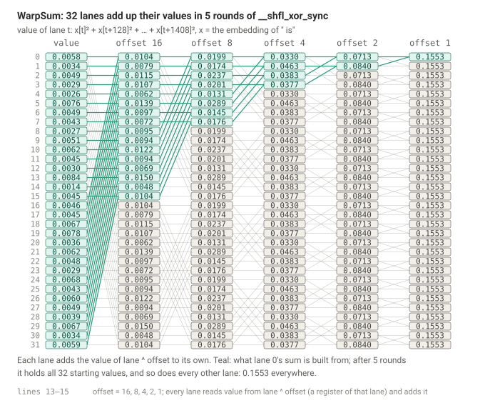

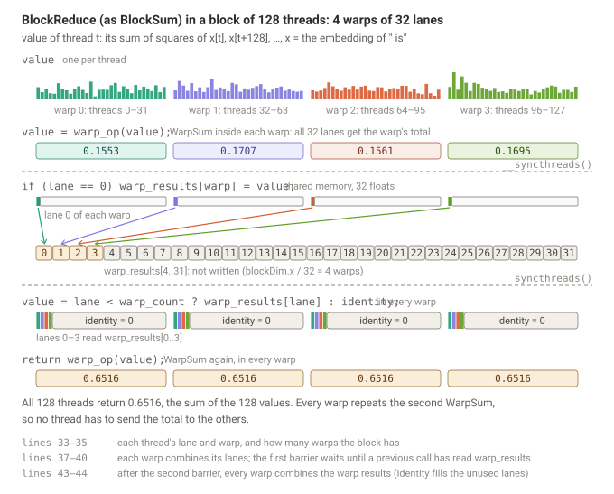

**Skip:** launch.cuh beyond its two names: `CeilDiv` (blocks to cover n items) and `RequireArgument`.

## 14 Normalize, add, activate

[engine/kernels/rms_norm.cu](../src/engine/kernels/rms_norm.cu) · [elementwise.cu](../src/engine/kernels/elementwise.cu) · builds on 13

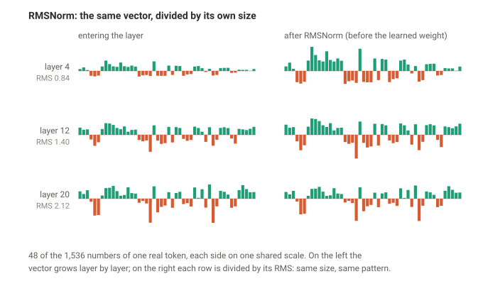

**Study**
- [`RmsNormKernel`]({engine/kernels/rms_norm.cu|__global__ void RmsNormKernel(const float* in, const float* weight, Out* out, int width, float epsilon) {}): one block per row. Sum the squares with `BlockSum`, then scale every value. Each thread loads its values once and keeps them for the second pass.

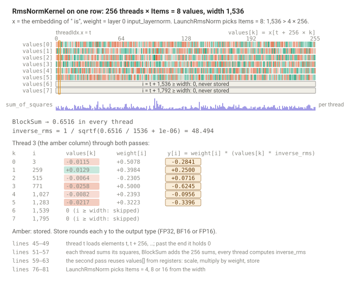

**Skim**
- [`SwiGluPairsKernel`]({engine/kernels/elementwise.cu|__global__ void SwiGluPairsKernel(const float2* pairs, float* out, __nv_bfloat16* rounded, std::size_t count) {}): the feed-forward's activation, `SiLU(gate) × up`, on pairs that sit next to each other in memory (chapter 22 explains why they're paired).

**Skip:** the conversion kernels, `AddBiasKernel`, `GatherRowsKernel` and `LaunchRmsNorm`.

**Notice:** most of the time these don't run as separate kernels at all. The next chapter does the norm and the activation inside the matrix-product kernel.

## 15 A matrix times one row

★ · [engine/kernels/weight_view.cuh](../src/engine/kernels/weight_view.cuh) · [weight_decode.cuh](../src/engine/kernels/weight_decode.cuh) · [matvec.cuh](../src/engine/kernels/matvec.cuh) · [matvec.cu](../src/engine/kernels/matvec.cu) · builds on 13

Generating one token multiplies every weight matrix by one vector, y = W·x: one multiply-add per weight read. So the kernel's job is reading memory as fast as possible. This is the most important kernel in the engine; take your time here.

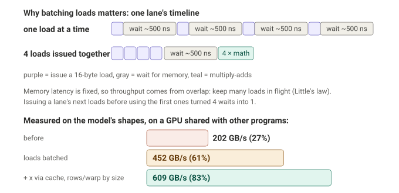

**Study**
- [`MatVecVectorKernel`]({engine/kernels/matvec.cu|MatVecVectorKernel(WeightView w, const float* __restrict__ x, float* __restrict__ y,}), top to bottom: the [norm prologue]({engine/kernels/matvec.cu|if constexpr (kNorm) {\n        float sum_of_squares = 0.0f;}), the [batched loads]({engine/kernels/matvec.cu|bits[r][k] = v < vectors ? __ldcs(rows[r] + v) : Bits{};}), the BF16 [`Dot8`]({engine/kernels/matvec.cu|__device__ __forceinline__ float Dot8(uint4 w, float4 a, float4 b) {}), and the [SwiGLU epilogue]({engine/kernels/matvec.cu|y[(first_row + r) / 2] = Silu(sums[r]) * sums[r + 1];}).

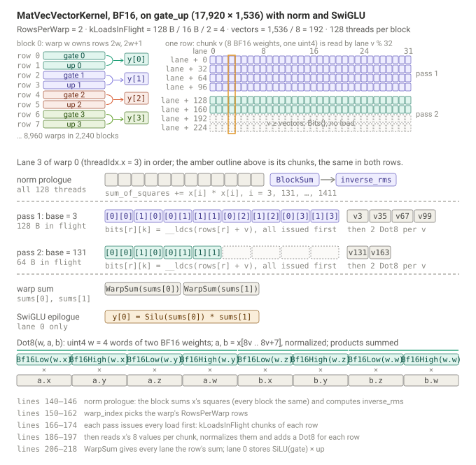

**Skim**
- [`WeightView`]({engine/kernels/weight_view.cuh|struct WeightView {}): a matrix as every kernel sees it, its format, shape and bytes. For now read only the BF16 [format]({engine/kernels/weight_view.cuh|enum class WeightFormat : std::uint8_t {}); FP8 and INT4 are Part VIII.
- [`Bf16ToFloat`]({engine/kernels/weight_decode.cuh|__device__ __forceinline__ float Bf16ToFloat(Bf16Bits bits) {}): a BF16 number is the top 16 bits of an FP32, so widening it is a shift.
- [`MatVecOptions`]({engine/kernels/matvec.cuh|struct MatVecOptions {}): the work fused into the product: RMSNorm before it, and bias, a residual add or SwiGLU after it.

**Skip:** the other `Dot8` overloads, `Packed8` and `RowsPerWarp` (Part VIII), `MatVecScalarKernel` (unaligned shapes), and the `Launch*` functions.

**Notice:** each lane starts 128 bytes of loads *before* it uses any of them. A load takes hundreds of cycles to arrive; with many started at once, the lane waits for them together, roughly once, instead of once per load.

**Why:** with one row, each weight read is used for one multiply, so the kernel's speed is set by how many bytes per second it reads. Fusing the norm and the epilogue means the vector is read and written once per product, not once per stage ([decode_performance.md](decode_performance.md)).

## 16 Rotate, then cache

[engine/kernels/paged_kv.cuh](../src/engine/kernels/paged_kv.cuh) · [rope.cu](../src/engine/kernels/rope.cu) · builds on 9, 13

After the q/k/v product, the query and key are rotated by their position (RoPE), and the key and value are written into the token's page of the cache.

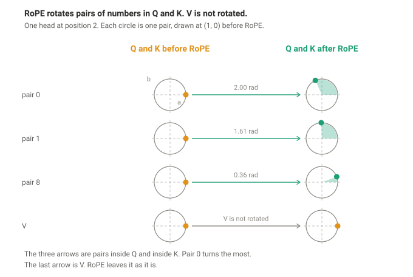

**Study**
- [`PagedRow`]({engine/kernels/paged_kv.cuh|__device__ __forceinline__ std::size_t PagedRow(const int* pages, int page_shift, int position) {}): the page-table lookup, `table[p / 16] * 16 + p % 16`, written with shifts.
- [`RopeAndCacheQkvKernel`]({engine/kernels/rope.cu|__global__ void RopeAndCacheQkvKernel(const float* qkv, const int* positions, const int* cache_rows,}), then [`RotateHead`]({engine/kernels/rope.cu|__device__ void RotateHead(const float* in, float* out, const float* inverse_frequencies, int head_dim,}): each pair of numbers in the vector is rotated like a point in 2D, by an angle proportional to the token's position. That's how attention can tell how far apart two tokens are.

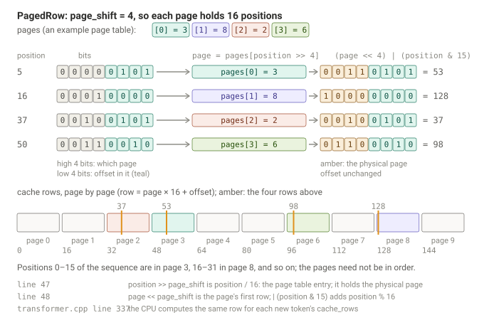

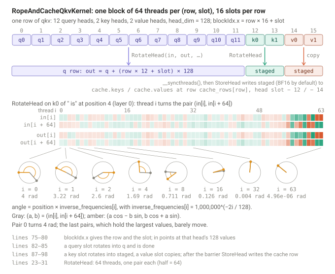

**Skim**
- [`KvLayer`]({engine/kernels/paged_kv.cuh|struct KvLayer {}) and [`PagedKv`]({engine/kernels/paged_kv.cuh|struct PagedKv {}): one layer's cache, and the page tables of chapter 9 copied to the GPU.

**Skip:** `StoreHead`'s FP8 branch (chapter 40), and everything below `PagedRow` in paged_kv.cuh (the loaders, chapter 28).

**Notice:** each row comes with its own destination in the cache (`cache_rows`), worked out on the CPU from its conversation's page table. So rows from different conversations are written to their own pages in one launch.

## 17 Attention, plainly

★ · [engine/kernels/attention.cuh](../src/engine/kernels/attention.cuh) · [attention.cu](../src/engine/kernels/attention.cu) · builds on 16

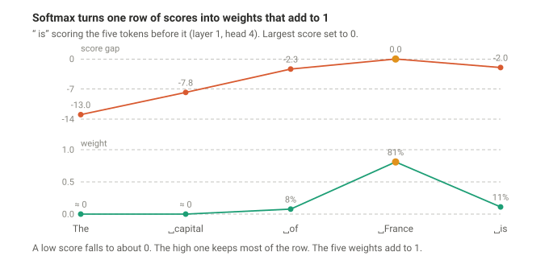

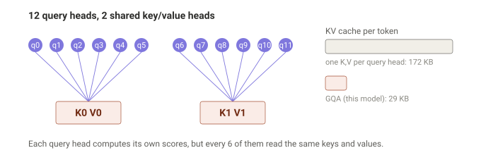

**Study**
- [`CausalAttentionKernel`]({engine/kernels/attention.cu|__global__ void CausalAttentionKernel(const float* q, KvLayer cache, PagedKv kv, QueryRows rows, float* out,}): attention in its three textbook steps, one block per head and row. Score the query against every earlier key, turn the scores into weights with a softmax, then add up the values, each multiplied by its weight. Keys and values are found through `PagedRow`.

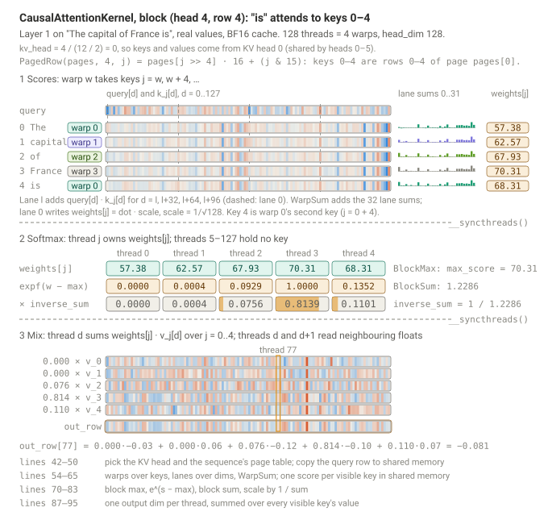

**Skim**
- [`QueryRows`]({engine/kernels/attention.cuh|struct QueryRows {}): each query row's position and which conversation's page table it uses.

**Skip:** everything from `kFlashRows` down (chapter 30).

**Notice:** six query heads share each key/value head (`kv_head = head / 6` here). That's grouped-query attention, and it's why the cache holds a sixth as many heads as the queries.

**Why:** this version is simple and exact, and it's what the engine runs in its exact mode, the one the reference tests use. Chapters 28 and 30 replace it with fast versions and test them against it.

## 18 Many rows on tensor cores

[engine/kernels/tensor_core.cuh](../src/engine/kernels/tensor_core.cuh) · [gemm.cuh](../src/engine/kernels/gemm.cuh) · [gemm.cu](../src/engine/kernels/gemm.cu) · builds on 15

With many rows (a prompt, or many conversations at once), each weight read feeds many multiplies. The work becomes arithmetic, which only the tensor cores do fast enough.

**Skim**
- tensor_core.cuh, all of it: three PTX instructions (the GPU's assembly level). [`CopyAsync16`]({engine/kernels/tensor_core.cuh|__device__ __forceinline__ void CopyAsync16(void* shared, const void* global, bool valid) {}) copies global memory into shared memory while the warp computes. [`LoadMatrixX4`]({engine/kernels/tensor_core.cuh|__device__ __forceinline__ void LoadMatrixX4(unsigned (&r)[4], const void* shared) {}) loads a tile into the per-thread layout the tensor cores expect (a **fragment**). [`Mma`]({engine/kernels/tensor_core.cuh|"mma.sync.aligned.m16n8k16.row.col.f32.f16.f16.f32}) multiplies a 16×16 tile by a 16×8 tile into a 16×8 FP32 result spread over the warp's 32 lanes, four numbers each.
- [`GemmKernel`]({engine/kernels/gemm.cu|GemmKernel(const __half* __restrict__ x, int rows, WeightView w, int tiles_per_split, Epilogue epilogue,}): the main loop. [`LoadTile`]({engine/kernels/gemm.cu|__device__ __forceinline__ void LoadTile(unsigned char* stage, const __half* x, int rows, const WeightView& w,}) brings the next tiles in while [`ComputeTile`]({engine/kernels/gemm.cu|__device__ __forceinline__ void ComputeTile(const unsigned char* stage, float (&acc)[kBlockM / 16][2][4]) {}) multiplies the current one, and [`Epilogue::Store`]({engine/kernels/gemm.cu|__device__ __forceinline__ void Store(int r, int c, float v0, float v1) const {}) adds the bias, residual or SwiGLU.

**Skip:** `WeightTile` and `WeightPair` (unpacking FP8 and INT4, chapter 39), `ReduceSplitsKernel`, `FinishScaledProductsKernel`, and everything from `BlockK` down.

## 19 Picking the token

[engine/kernels/argmax.cu](../src/engine/kernels/argmax.cu) · [sampling.cuh](../src/engine/kernels/sampling.cuh) · [sampling.cu](../src/engine/kernels/sampling.cu) · builds on 13

**Skim**
- [`ArgmaxKernel`]({engine/kernels/argmax.cu|__global__ void ArgmaxKernel(const float* values, int count, std::int32_t* out_index) {}): the highest-scoring token, found with chapter 13's warp-then-block reduction, comparing (score, index) pairs instead of summing.
- [`SamplingRow`]({engine/kernels/sampling.cuh|struct SamplingRow {}): one conversation's settings for the draw.
- [`SampleRowsKernel`]({engine/kernels/sampling.cu|__global__ void SampleRowsKernel(float* logits, int logits_stride, int candidate_count, const SamplingRow* rows,}): one block per conversation. Apply the repetition penalty, keep each thread's best candidates, merge them into the top k, then top-p and the draw.

**Skip:** `Candidate`'s helpers and the `allowed` mask test (chapter 45).

**Why:** the CPU does the same steps (chapter 26), but would need each conversation's 600 KB of scores copied back every step. On the GPU only the chosen ids come back.

**Tests:** for all of Part IV, [engine_kernels_tests.cpp](../tests/engine_kernels_tests.cpp): each kernel on small inputs (keys scattered over shuffled pages) against a CPU version you can read.

---

# Part V · The model on the GPU

This part puts the kernels together into the model: matrices in GPU memory, the right kernel for each product, the weights loaded from chapter 2's file, and a `Transformer` that runs a forward pass.

## 20 Weight matrices

[engine/weight_matrix.hpp](../src/engine/weight_matrix.hpp) · [weight_matrix.cpp](../src/engine/weight_matrix.cpp) · [blas.hpp](../src/engine/blas.hpp) · builds on 10, 15

**Skim**
- [`WeightMatrix`]({engine/weight_matrix.hpp|class WeightMatrix {}): owns a matrix's buffers on the GPU and hands out the `WeightView` of chapter 15.
- [`FromBf16`]({engine/weight_matrix.cpp|WeightMatrix WeightMatrix::FromBf16(DeviceBuffer<std::uint8_t> bf16, int out_features, int in_features,}): only its BF16 case for now; it keeps the buffer as it is.
- [`Blas`]({engine/blas.hpp|class Blas {}): the header only. It wraps cuBLAS, NVIDIA's matrix library, for the products the engine doesn't do with its own kernel.

**Skip:** the FP8 and INT4 cases (chapter 37), blas.cpp, and channel_importance (chapter 37).

## 21 One product, the right kernel

★ · [engine/linear.hpp](../src/engine/linear.hpp) · [linear.cpp](../src/engine/linear.cpp) · builds on 14, 15, 18, 20

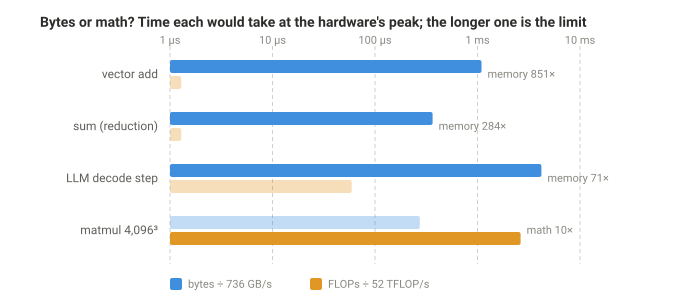

**Study**
- [`Linear::Apply`]({engine/linear.cpp|void Linear::Apply(const float* x, const WeightMatrix& weight, float* y, int rows, const MatVecOptions& options) {}): one row goes to [`MatVec`]({engine/linear.cpp|MatVec(weight.View(), x + static_cast<std::size_t>(r) * in, y + static_cast<std::size_t>(r) * out,}); up to 48 rows to [`ApplyTensorCores`]({engine/linear.cpp|void Linear::ApplyTensorCores(const float* x, const WeightMatrix& weight, float* y, int rows,}) (our `GemmF16`); more rows to the [fastest path for the format]({engine/linear.cpp|const bool fastest = math_ == MultiRowMath::kFastest && rows > kGemmF16Rows;\n    if (exact) {}).

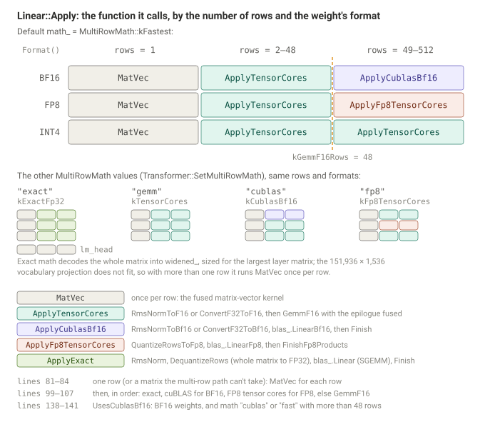

**Skim**
- [`MultiRowMath`]({engine/linear.hpp|enum class MultiRowMath {}): the ways several rows can be multiplied, each line commented.
- [`ApplyExact`]({engine/linear.cpp|void Linear::ApplyExact(const float* x, const WeightMatrix& weight, float* y, int rows, const MatVecOptions& options) {}): slower, but the same arithmetic as one row. The reference tests use it.

**Skip:** `ApplyCublasBf16`, `ApplyFp8TensorCores` (chapter 39), `FeedForward` (chapter 29), and the `statistics_` lines (chapter 37).

**Why:** with one row, speed depends on reading memory, and the matrix-vector kernel is fastest. With many rows, speed depends on arithmetic, and the tensor cores are fastest. The crossover, 48 rows, was measured with `murmur-lab batch`.

## 22 Loading the weights

[engine/model_weights.hpp](../src/engine/model_weights.hpp) · [model_weights.cpp](../src/engine/model_weights.cpp) · [model_loader.cpp](../src/engine/model_loader.cpp) · builds on 2, 3, 5, 20

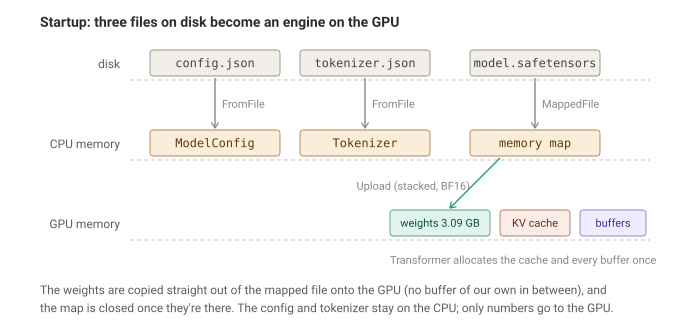

**Skim**
- [`LayerWeights`]({engine/model_weights.hpp|struct LayerWeights {}): one layer's weights, each field's shape in its comment.
- [`ModelWeights::Upload`]({engine/model_weights.cpp|ModelWeights ModelWeights::Upload(const SafetensorsFile& file, const ModelConfig& config, WeightFormat format,}): walks the 28 layers and copies each matrix from the mapped file to the GPU, checking every shape against the config.
- [`LoadModel`]({engine/model_loader.cpp|LoadedModel LoadModel(const std::filesystem::path& model_dir, TransformerOptions options, WeightFormat format,}): about a dozen lines that run Part I and this chapter in order: read the config, read the tokenizer, check they agree on the vocabulary, upload the weights, build the `Transformer`.

**Skip:** `TensorUploader`'s helpers below `StackedMatrix` and `InterleavedMatrix`, `CollectImportance`, `LoadSpeculator` (chapter 46).

**Notice** the [stacking]({engine/model_weights.cpp|layer.qkv_proj = uploader.StackedMatrix({{p + "self_attn.q_proj.weight", q_width},}). The q, k and v projections read the same input, so they're glued into one 2,048-row matrix. Gate and up become one 17,920-row matrix, [interleaved]({engine/model_weights.cpp|WeightMatrix InterleavedMatrix(const std::string& first, const std::string& second, int rows, int in_features,}) row by row (gate 0, up 0, gate 1, ...), so every pair of outputs holds both halves of one SwiGLU (chapter 15's epilogue). One big product replaces two or three small ones.

**Notice:** the weights file is opened [inside `LoadWeights`]({engine/model_loader.cpp|const SafetensorsFile file(model_dir / "model.safetensors");}), so it's unmapped the moment that function returns.

## 23 The cache on the GPU

[engine/kv_cache.hpp](../src/engine/kv_cache.hpp) · [kv_cache.cpp](../src/engine/kv_cache.cpp) · builds on 3, 16

**Skim**
- the comment above [`PagedKvCache`]({engine/kv_cache.hpp|class PagedKvCache {}): every layer's keys and values, one row per cached token.
- [the constructor]({engine/kv_cache.cpp|PagedKvCache::PagedKvCache(const ModelConfig& config, int page_count, int page_size, KvFormat format)}): every layer in one allocation. [`Layer`]({engine/kv_cache.cpp|KvLayer PagedKvCache::Layer(int layer) {}) returns the pointers to one layer's keys and values that the kernels take.

**Skip:** the format names and parsers, `LayerKvFormat` (chapter 40).

**Notice:** this class only holds memory. Who owns which page is chapter 9's job. The only link between the two is the page table: chapter 9's page numbers pick rows in this memory.

## 24 Allocate everything once

[engine/transformer.hpp](../src/engine/transformer.hpp) · [transformer.cpp](../src/engine/transformer.cpp) · builds on 9, 11, 21, 22, 23

**Skim**
- [`TransformerOptions`]({engine/transformer.hpp|struct TransformerOptions {}): the worst case the buffers are sized for (512 tokens and 64 conversations in one step).
- the private members at the end of the header, from `config_` down: everything the forward pass touches, each commented.
- [the constructor]({engine/transformer.cpp|Transformer::Transformer(const ModelConfig& config, ModelWeights weights, TransformerOptions options)}): [`KvPageCount`]({engine/transformer.cpp|int KvPageCount(const ModelConfig& config, const TransformerOptions& options) {}) turns the cache's byte budget into pages (a BF16 page is 448 KB). Then every activation is allocated, and one [pinned input buffer]({engine/transformer.cpp|inputs_host_ = PinnedBuffer<int>(layout_.total);}) holds everything a step needs from the CPU: token ids, positions, page tables.

**Skip:** `CheckedOptions` and `LinearLimitsFor` (sizes and checks), and for now the public methods below `Forward`.

**Notice:** after this point, generating text never calls `cudaMalloc`; switching formats (chapter 41) is the one deliberate exception. Allocation is slow and can fail, and doing it once means a reply can't stall or run out of memory halfway.

## 25 One forward pass

★ · [engine/transformer.cpp](../src/engine/transformer.cpp) · builds on 24

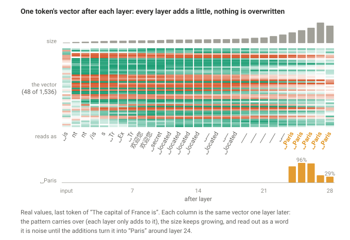

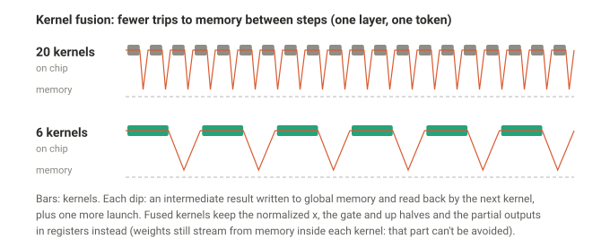

**Study**
- [`StepEntry`]({engine/transformer.hpp|struct StepEntry {}): one conversation's part of a step: its page table, its next tokens, how many logits it wants.
- [`Transformer::Step`]({engine/transformer.cpp|void Transformer::Step(std::span<const StepEntry> entries, ForwardObserver* observer) {}), then [`StageInputs`]({engine/transformer.cpp|Transformer::StepShape Transformer::StageInputs(std::span<const StepEntry> entries) {}): each row gets its token, its position and its [cache row]({engine/transformer.cpp|host[layout_.row_cache + row] = (sequence.pages[position >> page_shift_] << page_shift_) | (position & mask);}) through the page table. One-token entries [go first]({engine/transformer.cpp|if (count == 1 || entries[i].decode_each_token) {}).
- [`ForwardLayer`]({engine/transformer.cpp|void Transformer::ForwardLayer(int layer, const StepShape& shape, ForwardObserver* observer) {}): the comment above it is the layer in six lines, and the body is the same six calls:

| Line | Call | What it does |
| --- | --- | --- |
| [qkv]({engine/transformer.cpp|linear_.Apply(hidden_.Data(), w.qkv_proj, qkv_.Data(), rows,}) | `linear_.Apply(…, w.qkv_proj, …)` | RMSNorm, then q, k, v in one product, plus the bias |
| [rope]({engine/transformer.cpp|RopeAndCacheQkv(qkv_.Data(), rows, DeviceInputs(layout_.row_positions), DeviceInputs(layout_.row_cache),}) | `RopeAndCacheQkv` | rotate q and k; write k and v to each row's cache row (chapter 16) |
| [decode]({engine/transformer.cpp|DecodeAttention(q_.Data(), cache, kv, DeviceInputs(layout_.contexts),}) / [prompt]({engine/transformer.cpp|FlashAttention(q_.Data() + offset, cache, kv, query_rows, rows - shape.decode_rows,}) | `DecodeAttention` / `FlashAttention` | attention for decode rows and prompt rows (chapters 28 and 30; exact mode uses chapter 17's) |
| [o_proj]({engine/transformer.cpp|linear_.Apply(attention_.Data(), w.o_proj, hidden_.Data(), rows, {.accumulate = true});}) | `linear_.Apply(…, w.o_proj, …, accumulate)` | output projection, added onto the residual stream |
| [feed-forward]({engine/transformer.cpp|linear_.FeedForward(hidden_.Data(), w.gate_up_proj, w.down_proj, activation_.Data(), rows, w.mlp_norm.Data(),}) | `linear_.FeedForward(…)` | RMSNorm, gate and up in one product, SwiGLU, the down projection, added onto the residual stream |

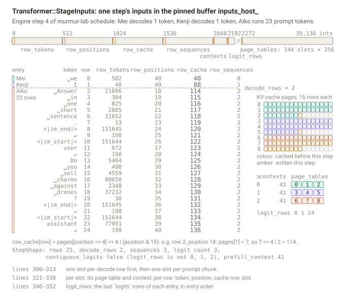

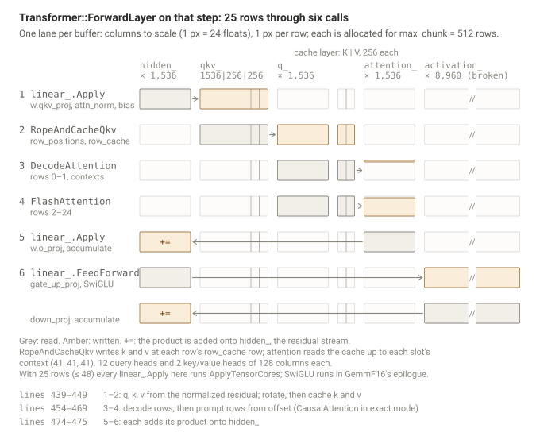

**Skim**
- [`EnqueueStep`]({engine/transformer.cpp|void Transformer::EnqueueStep(const StepShape& shape, ForwardObserver* observer, bool all_logits) {}): embeddings, 28 layers, logits.
- [`EnqueueLogits`]({engine/transformer.cpp|void Transformer::EnqueueLogits(const StepShape& shape, ForwardObserver* observer, bool all_logits) {}): the vocabulary projection, only for the [rows that want logits]({engine/transformer.cpp|linear_.Apply(x, weights_.LmHead(), logits_.Data(), shape.logit_count, final_norm);}).

**Skip:** `ValidateEntries` (it checks everything the kernels will trust), `RunStep`'s graph branch (chapter 29), the `Observe` calls (they let tests compare every layer with the reference), and the `all_logits` branch.

**Notice:** `accumulate` isn't a separate kernel; the product writes `y += W·x` directly. Fusing like this is how a layer went from about 20 kernels to 6.

**Why:** each layer reads the running vector (the *residual stream*), computes a change and adds it back, so 28 layers refine it in turn. Every separate kernel would write its result to memory for the next to read back; merging stages saves that traffic and the launches.

**Tests:** [transformer_tests.cpp](../tests/transformer_tests.cpp): every layer against the reference, batched steps against single ones. [correctness.md](correctness.md) explains the reference data.

## 26 Sampling

[engine/sampler.hpp](../src/engine/sampler.hpp) · [sampler.cpp](../src/engine/sampler.cpp) · [gpu_sampler.cpp](../src/engine/gpu_sampler.cpp) · builds on 19

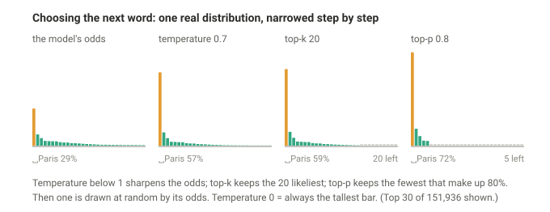

**Study**
- [`Sampler::Pick`]({engine/sampler.cpp|TokenId Sampler::Pick(std::span<float> logits, std::span<const TokenId> history, double unit_draw) const {}): the CPU version, easy to follow. Penalty, temperature, top-k, top-p, then the draw.

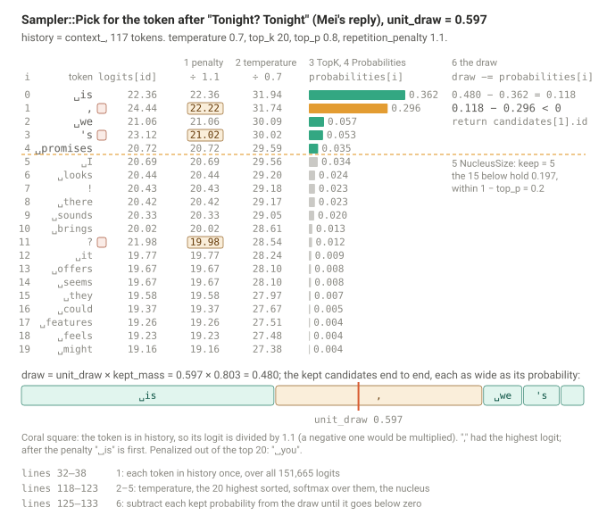

**Skim**
- [`SamplingParams`]({engine/sampler.hpp|struct SamplingParams {}): the model's recommended settings.
- [`GpuSampler::Sample`]({engine/gpu_sampler.cpp|std::span<const TokenId> GpuSampler::Sample(float* logits, int logits_stride, int candidate_count,}): copies every row's settings and penalty tokens to the GPU, runs chapter 19's kernel once, and [waits for the ids]({engine/gpu_sampler.cpp|CudaCheck(cudaStreamSynchronize(stream));}).

**Skip:** the helpers above `Pick` (each is one step of it), and `Validate`.

**Notice:** that wait is the only point in a step where the CPU stops until the GPU catches up. Everything before it is queued on one stream, which runs it in order.

**Tests:** [sampler_tests.cpp](../tests/sampler_tests.cpp), [gpu_sampler_tests.cpp](../tests/gpu_sampler_tests.cpp): GPU and CPU pick the same token for the same draw.

## 27 The first conversation

★ · [engine/chat_session.hpp](../src/engine/chat_session.hpp) · [chat_session.cpp](../src/engine/chat_session.cpp) · builds on 6, 25, 26

Everything so far, used by the simplest caller: one character, one conversation, one token at a time. `murmur-lab chat` runs it in the terminal.

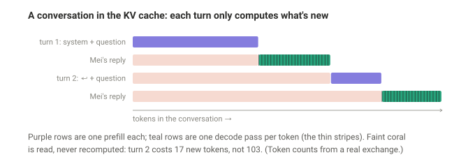

**Study**
- [`ChatSession::Reply`]({engine/chat_session.cpp|std::string ChatSession::Reply(std::string_view message, const TextCallback& on_text, std::stop_token stop,}): encode the turn, [prefill it]({engine/chat_session.cpp|transformer_->Forward(prompt, TokensInContext());}), then loop: pick a token, stream its text, [run it]({engine/chat_session.cpp|transformer_->Forward(std::span(&next, 1), TokensInContext());}), until end of turn.

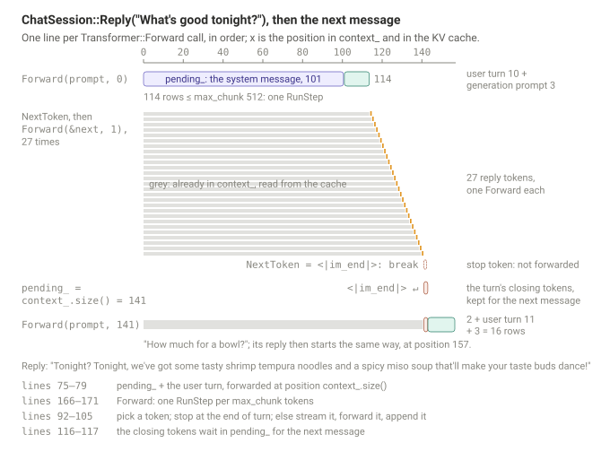

**Skim**
- [`Transformer::Forward`]({engine/transformer.cpp|void Transformer::Forward(std::span<const TokenId> tokens, int start_position, LogitsRows logits_rows,}): one sequence, on the transformer's own page table. Reserve pages, run the tokens in chunks, advance the length.

**Skip:** `ReplyStats`, the timing lines, and `Reset`.

**Notice:** the turn's closing tokens are [kept for the next message]({engine/chat_session.cpp|pending_.push_back(template_.EndOfTurn());}) rather than run now. The KV cache keeps the conversation, so the next message only computes its own tokens.

**Why:** attention needs every earlier token's keys and values. Cached, each new token costs one token's work; without the cache, every step would recompute the whole conversation.

At this point the engine works. Every part after this one either makes it faster or does more with it.

---

# Part VI · Faster steps

Chapter 27's loop runs one conversation at about 190 tokens per second, close to the limit the memory bandwidth sets. Three pieces get it there. [decode_performance.md](decode_performance.md) measures each one.

## 28 Attention for one new token, split

★ · [engine/kernels/decode_attention.cu](../src/engine/kernels/decode_attention.cu) · builds on 16, 17

Chapter 17 gives a decode token one block per head: 12 blocks for a GPU with 80 cores. This kernel cuts the context into slices so many blocks share one token's attention, then merges their results.

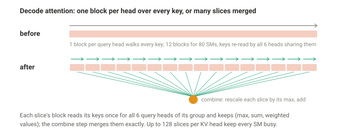

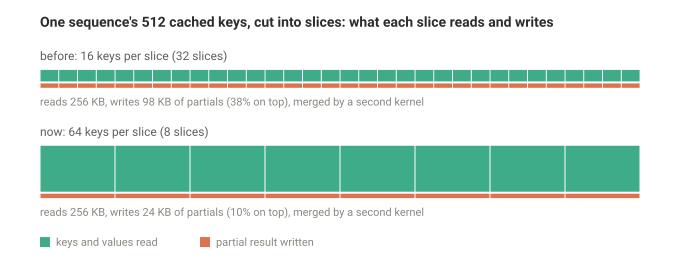

**Study**
- [`CombineSplitsKernel`]({engine/kernels/decode_attention.cu|__global__ void CombineSplitsKernel(const int* context_lengths, int num_heads, int head_dim,}): merges the slices exactly. Each slice's sum is rescaled by `e^(its max − the overall max)`.

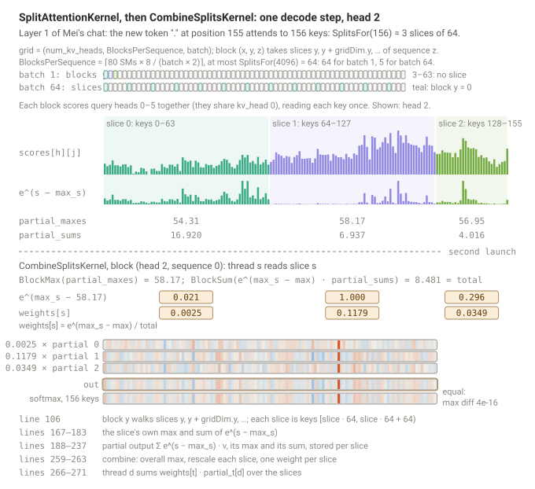

**Skim**
- the comment at the top of the file, then [`SplitAttentionKernel`]({engine/kernels/decode_attention.cu|SplitAttentionKernel(const float* q, KvLayer cache, PagedKv kv, const int* context_lengths, int num_heads,}): [`SplitsFor`]({engine/kernels/decode_attention.cu|__host__ __device__ constexpr int SplitsFor(int context) {}) cuts the context into 64-key slices, and each block [loops over its share of the slices]({engine/kernels/decode_attention.cu|for (int slice = blockIdx.y; slice < SplitsFor(context); slice += gridDim.y) {}), [issuing every load of a slice first]({engine/kernels/decode_attention.cu|// 0. Every load of the slice at once: the values don't depend on the}). Then [scores]({engine/kernels/decode_attention.cu|    // 1. Scores.\n#pragma unroll}), the [softmax]({engine/kernels/decode_attention.cu|// 2. Softmax, a warp per head: the slice's max and e^(s - max).}), and the weighted values.
- [`LoadKvChunk`]({engine/kernels/paged_kv.cuh|__device__ __forceinline__ KvChunk<F> LoadKvChunk(}): 8 values per load, kept in the cache's format (BF16, say) until the math needs them.

**Skip:** [`BlocksPerSequence`]({engine/kernels/decode_attention.cu|int BlocksPerSequence(int batch, int num_kv_heads, int max_context) {}) beyond its comment, and the `Launch*` templates.

**Notice:** the slice size depends only on the context, never on the batch. The first version sized slices by the batch, and a test that compares speculative replies with plain ones failed. Adding the same numbers in a different order gives slightly different floating-point results, so the two paths disagreed. A kernel test alone wouldn't have caught it, because the kernel was correct on its own.

## 29 Recorded steps

★ · [engine/transformer.cpp](../src/engine/transformer.cpp) · builds on 11, 25

A decode step is about 200 small kernels, and launching each from the CPU takes about as long as the GPU needs to run it.

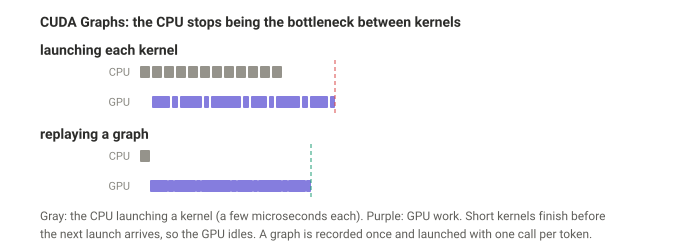

**Skim**
- [`RunStep`]({engine/transformer.cpp|void Transformer::RunStep(std::span<const StepEntry> entries, ForwardObserver* observer, bool all_logits) {}): a decode-only step replays the [graphs recorded for its batch size]({engine/transformer.cpp|std::vector<CudaGraph>& pieces = decode_graphs_[shape.sequences];}); anything else launches every kernel directly.
- [`RecordDecodeStep`]({engine/transformer.cpp|std::vector<CudaGraph> Transformer::RecordDecodeStep(const StepShape& shape) {}): records a step as pieces of 4 layers. `RunStep` [launches each piece]({engine/transformer.cpp|for (const CudaGraph& piece : pieces) {}) and flushes it (chapter 11). Without the flush, Windows' display driver keeps submitted work in a buffer instead of sending it on, and the GPU sits idle while the CPU launches the rest.
- [`RecordDecodeGraphs`]({engine/transformer.cpp|void Transformer::RecordDecodeGraphs() {}): every batch size, recorded at startup using [only the batch size]({engine/transformer.cpp|Transformer::StepShape Transformer::DecodeShape(int sequences) {}).
- [`Linear::FeedForward`]({engine/linear.cpp|void Linear::FeedForward(float* x, const WeightMatrix& gate_up, const WeightMatrix& down, float* activation, int rows,}): the feed-forward with SwiGLU [writing the 16-bit copy]({engine/linear.cpp|SwiGluPairs(gate_up_.Data(), activation, rows, width, stream_, input16_.Data());}) the down projection reads, so no separate kernel has to convert it.

**Notice:** a graph replays the same launches every time, so every per-step input, page tables included, lives in GPU memory, copied from the pinned buffer at the start of the step. That's why chapter 24 put them all in one buffer.

**Notice:** exact mode once allocated its scratch on first use. Recorded at startup, that first use fell inside a graph being recorded, where allocating isn't allowed; [`SetMultiRowMath`]({engine/linear.cpp|void Linear::SetMultiRowMath(MultiRowMath math) {}) now allocates it up front.

**Tests:** [transformer_tests.cpp](../tests/transformer_tests.cpp): `GraphReplayMatchesLaunchingEachKernel`, `GraphsRecordedAheadMatchGraphsRecordedOnDemand`.

## 30 Attention for a prompt

[engine/kernels/attention.cu](../src/engine/kernels/attention.cu) · builds on 17, 18

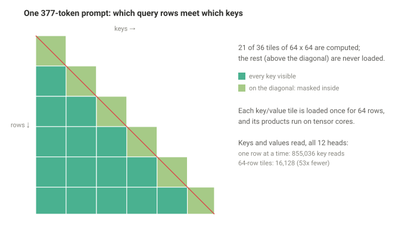

A prompt's attention is a full matrix product (64 queries against every key), so it belongs on tensor cores. [`FlashAttentionKernel`]({engine/kernels/attention.cu|FlashAttentionKernel(const float* q, KvLayer cache, PagedKv kv, QueryRows rows, int row_count, float* out,}), in the order it runs:

1. The block's 64 query rows go to shared memory as FP16, and each warp [loads its 16 rows as fragments]({engine/kernels/attention.cu|LoadMatrixX4(qa[k], &q_or_v[(warp * 16 + lane % 16) * kPitch + k * 16 + lane / 16 * 8]);}) once.
2. [Each run of one conversation's rows]({engine/kernels/attention.cu|for (int start = 0; start < tile_rows;) {}) walks that conversation's keys in tiles of 64, loaded once into shared memory.
3. [S = Q · Kᵀ]({engine/kernels/attention.cu|// 1. S = Q . K^T for the warp's 16 rows and the tile's 64 keys.}) with `Mma`.
4. The [online softmax]({engine/kernels/attention.cu|// 2. Online softmax (log2 domain: exp2 is one instruction).}): the running max and sum per row stay in registers.
5. O += P · V, with [P's fragments built directly from S's results in registers]({engine/kernels/attention.cu|const unsigned p[4] = {Bits(__floats2half2_rn(s[2 * k][0], s[2 * k][1])),}), and V read with [`LoadMatrixX4Transposed`]({engine/kernels/tensor_core.cuh|__device__ __forceinline__ void LoadMatrixX4Transposed(}) because it's stored keys-major.

**Study** step 4, the online softmax: it's the idea that makes FlashAttention work. **Skim** the other steps.

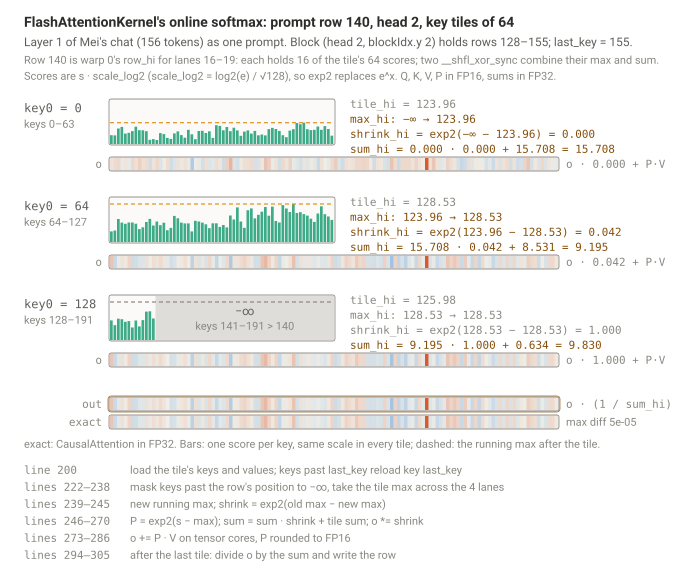

**Skip:** `StoreHalf8` and `LaunchFlash`.

**Why:** the online softmax processes each tile of keys once and then discards it, keeping only a running max and sum per row, so the full score matrix is never stored.

**Tests:** `FlashAttentionMatchesTheReferenceAcrossTilesAndPrompts` in [engine_kernels_tests.cpp](../tests/engine_kernels_tests.cpp): three prompts in one call, two continuing after cached keys, tile boundaries inside them.

---

# Part VII · Many conversations

With one conversation, each step reads all 3 GB of weights to produce a single token, and the GPU's arithmetic units sit mostly idle. The `Engine` runs every conversation that has work in the same step, so one weight read serves them all. Conversations join and leave at any step.

## 31 Conversations

[engine/engine.hpp](../src/engine/engine.hpp) · [engine.cpp](../src/engine/engine.cpp) · builds on 6, 9, 25

engine.cpp is the largest file in the engine. Read it over chapters 31–35 in the order given, not top to bottom.

**Study**
- [`Engine::Conversation`]({engine/engine.hpp|struct Conversation {}): its tokens so far and `kv`, its place in the cache. Read down to `send_order`, the fields this part uses.

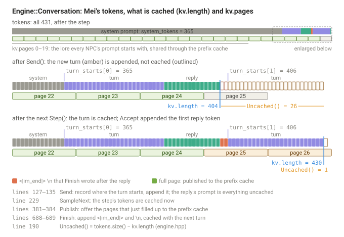

**Skim**
- [`ConversationOptions`]({engine/engine.hpp|struct ConversationOptions {}), `EngineEvent` and the public methods of `Engine`: open a conversation, send a message, run a step, get events back.
- [`Engine::Open`]({engine/engine.cpp|void Engine::Open(ConversationId id, ConversationOptions options) {}): encodes the system prompt and computes nothing yet.
- [`Engine::Send`]({engine/engine.cpp|void Engine::Send(ConversationId id, std::string_view message, std::optional<int> priority) {}): [appends]({engine/engine.cpp|Append(c, turn);}) the turn without running it. If the turn plus the longest reply wouldn't fit the conversation's budget, the [oldest turns are forgotten]({engine/engine.cpp|void Engine::Rebuild(Conversation& c, std::size_t first_kept_turn) {}) first, keeping the system prompt and the [newest turns that fill half of what's left]({engine/engine.cpp|const std::size_t keep = std::min(room / 2, room - needed);}).

**Skip:** the fields from `draws` down (chapters 45–46), `EngineStats`, `Close`, `Cancel`, and `Stats` (chapter 50).

**Notice:** the first `kv.length` tokens are cached, the rest still have to run. `Send` only adds tokens past `kv.length`; the next step decides when they run.

## 32 One engine step

★ · [engine/engine.cpp](../src/engine/engine.cpp) · builds on 31

[`Engine::Step`]({engine/engine.cpp|std::vector<EngineEvent> Engine::Step() {}) is short. With the bookkeeping removed:

```cpp
plan = Plan()                    // chapter 33: who runs, and how many tokens each
Speculate(plan)                  // chapter 46: the draft model may add guesses
transformer.Step(Entries(plan))  // one forward pass for all of them
next = SampleNext(plan)          // advance kv.length, then sample every row at once
TakeTokens(plan, next)           // chapter 35: each conversation takes its token
```

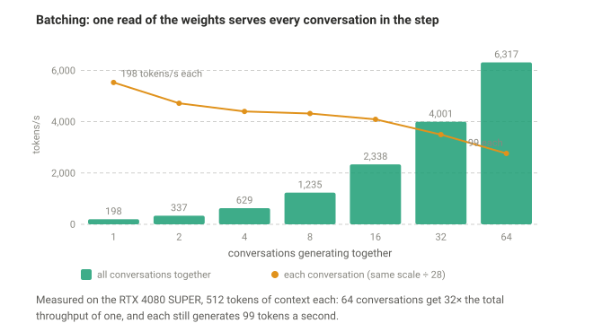

**Study**
- [`Engine::Step`]({engine/engine.cpp|const std::vector<StepEntry> entries = Entries(plan);}): the five calls above, in the code.
- [`SampleNext`]({engine/engine.cpp|std::span<const TokenId> Engine::SampleNext(const std::vector<Planned>& plan, const std::vector<StepEntry>& entries) {}): the lengths [advance]({engine/engine.cpp|c.kv.length += plan[i].count;}) only now, after the pass wrote the keys and values, and full pages are [offered to the prefix cache]({engine/engine.cpp|Cache().Publish(c.kv, std::span(c.tokens).first(static_cast<std::size_t>(full_pages) * Cache().PageSize()));}).

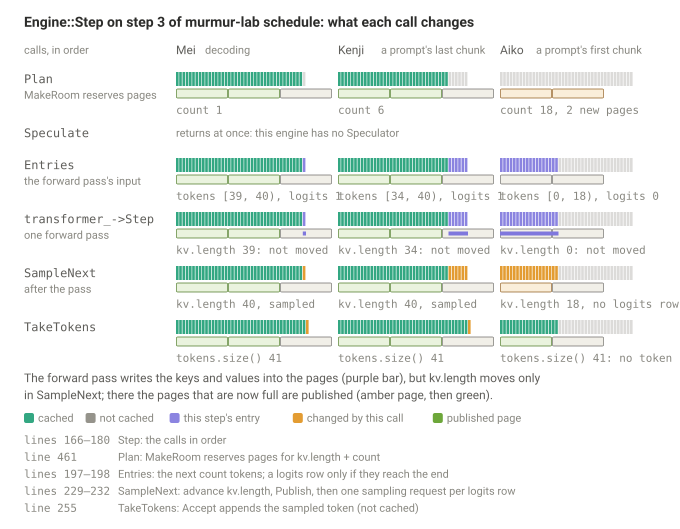

**Skim**
- [`Entries`]({engine/engine.cpp|std::vector<StepEntry> Engine::Entries(const std::vector<Planned>& plan) {}): the plan as chapter 25's `StepEntry`s. A conversation wants logits only when the entry reaches the end of its uncached tokens.
- [`TakeTokens`]({engine/engine.cpp|void Engine::TakeTokens(const std::vector<Planned>& plan, const std::vector<StepEntry>& entries,}).

**Skip:** the `drafted > 0` branches (chapter 46) and `RecordBatch`.

**Why:** decode is memory-bound. A step's time is mostly reading 3 GB of weights, and that read is the same for one conversation or thirty-two. [serving_performance.md](serving_performance.md) has the curve.

## 33 Planning the batch

★ · [engine/engine.cpp](../src/engine/engine.cpp) · builds on 32

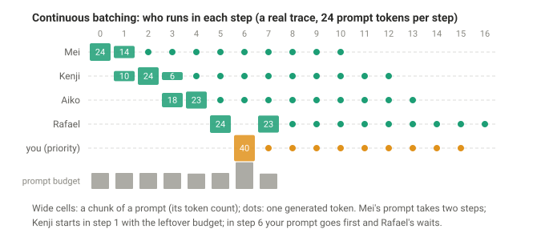

**Study** all of [`Engine::Plan`]({engine/engine.cpp|std::vector<Engine::Planned> Engine::Plan(std::vector<EngineEvent>& events) {}), step by step:

1. Cancelled replies [end first]({engine/engine.cpp|Finish(c, true, events);\n        } else if (c.replying && c.Uncached() > 0) {}).
2. Every conversation with tokens to run is [sorted]({engine/engine.cpp|std::ranges::sort(runnable, [](const Conversation* a, const Conversation* b) {}): higher priority first; then decoding conversations (one uncached token, the one just sampled) before prompts. The player's message is at the front.
3. A conversation starting from nothing first [reuses any cached prefix]({engine/engine.cpp|const int reused = Cache().AttachPrefix(c->kv, c->tokens);}) (chapter 9): for an NPC, the city lore is already there.
4. Prompts are [cut to the budget]({engine/engine.cpp|const int count = uncached == 1 ? 1 : std::min(uncached, budget);}) (chunked prefill), though a [higher-priority prompt]({engine/engine.cpp|const int budget = c->Priority() > 0 ? rows_left : std::min(prefill_left, rows_left);}) like the player's may use the whole step. Then each conversation [gets pages]({engine/engine.cpp|if (count <= 0 || !MakeRoom(*c, c->kv.length + count, plan)) {}); one that can't is skipped this step.
5. The plan [stops]({engine/engine.cpp|if (static_cast<int>(plan.size()) == limits.max_batch || rows_left == 0) {}) at 64 conversations or 512 rows.

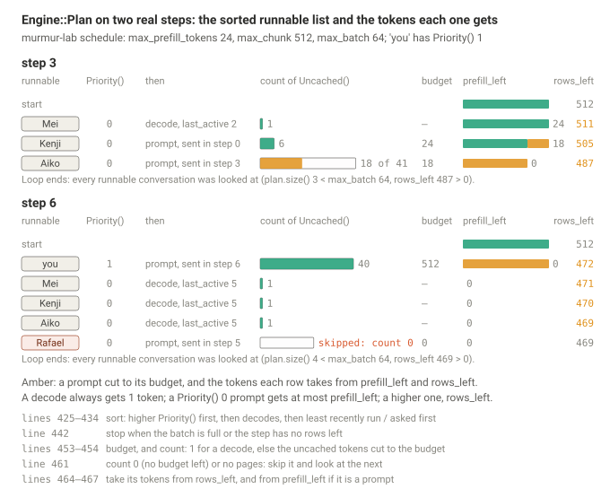

**Why:** a decode row is one token that keeps a reply flowing; a prompt can be hundreds. Cutting prompts into chunks keeps every step short, so no NPC's words stall behind someone else's long prompt.

**Try it:** `murmur-lab schedule` prints every step's plan for five conversations.

## 34 When memory runs out

★ · [engine/engine.cpp](../src/engine/engine.cpp) · builds on 33

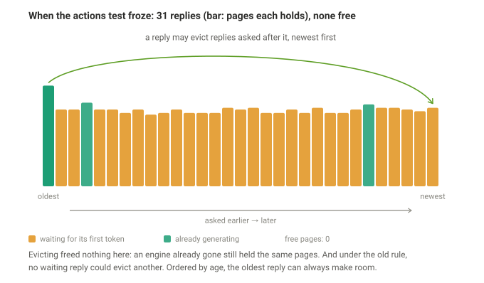

**Study**
- [`Engine::MakeRoom`]({engine/engine.cpp|bool Engine::MakeRoom(Conversation& c, int length, const std::vector<Planned>& planned) {}): picks [victims]({engine/engine.cpp|if (!other.replying || other.Priority() < c.Priority() || other.send_order > c.send_order) {}): idle conversations of its priority or lower, replying ones of lower priority, and replying ones of its own priority only if they were [asked after it]({engine/engine.cpp|c.send_order = sends_++;}). Then it [evicts them one at a time]({engine/engine.cpp|for (Conversation* victim : victims) {}) until the pages fit.

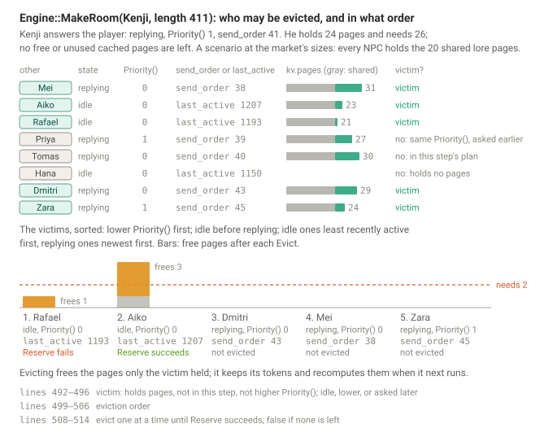

**Skim**
- [`Evict`]({engine/engine.cpp|void Engine::Evict(Conversation& c) {}): the conversation keeps its tokens; its `kv.length` drops to zero, so its next turn recomputes them, with whatever the prefix cache still holds.

**Notice:** the age rule does two jobs. Evictions only run from older to newer, so two replies can't take turns evicting each other (30 NPCs once did, 1,969 times in 30 s). And the oldest reply can always make room, so the market can't get stuck with every reply holding some pages and waiting for more.

**Tests:** [engine_tests.cpp](../tests/engine_tests.cpp): eviction, priority, everyone needing room at once.

## 35 Tokens out

[engine/engine.cpp](../src/engine/engine.cpp) · builds on 32

**Skim**
- [`Engine::Accept`]({engine/engine.cpp|void Engine::Accept(Conversation& c, TokenId token, std::vector<EngineEvent>& events, bool drafted) {}): records the time to the first token, ends the reply at an end-of-turn token, and otherwise decodes the token to text (chapter 5's `StreamingDecoder`) and [appends]({engine/engine.cpp|Append(c, std::span(&token, 1));\n    if (c.stats.reply_tokens >= c.options.max_reply_tokens) {}) it so it runs in the next step.
- [`Emit`]({engine/engine.cpp|void Engine::Emit(Conversation& c, std::string text, std::vector<EngineEvent>& events, bool drafted) {}): text becomes a `kText` event.
- [`Engine::Finish`]({engine/engine.cpp|void Engine::Finish(Conversation& c, bool truncated, std::vector<EngineEvent>& events) {}): flushes the decoder, [appends the turn's closing tokens]({engine/engine.cpp|Append(c, std::span(&end_of_turn, 1));}) (run with the next message, as in chapter 27), and reports the reply's stats.

**Skip:** the `phase` branches and `StartAction` (chapter 45).

**Notice:** one reply per conversation at a time: [`Send` throws]({engine/engine.cpp|throw std::logic_error("Engine::Send: the previous reply hasn't finished");}) if one is still running.

**Tests:** [engine_tests.cpp](../tests/engine_tests.cpp): `OneConversationReproducesTheReferenceReply`, `ConversationsJoinAndLeaveTheBatchAtAnyStep`, chunked prompts, sharing, forgetting.

## 36 The worker thread

★ · [engine/inference_service.hpp](../src/engine/inference_service.hpp) · [inference_service.cpp](../src/engine/inference_service.cpp) · builds on 22, 35

The game draws 60 frames a second and must never wait for the GPU. `InferenceService` runs the engine on its own thread; the game sends commands and collects events.

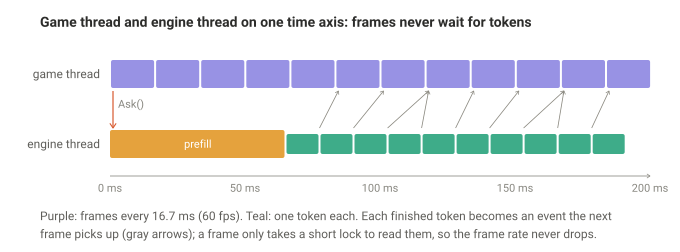

**Study**
- [`Run`]({engine/inference_service.cpp|void InferenceService::Run(std::stop_token stop) {}), everything the worker does: [load the model]({engine/inference_service.cpp|model.emplace(LoadModel(options_.model_dir, options_.transformer, options_.weights, options_.memory_budget));}), [record the graphs]({engine/inference_service.cpp|model->transformer->RecordDecodeGraphs();}), [create the `Engine`]({engine/inference_service.cpp|engine.emplace(*model->transformer, model->tokenizer, options_.engine, speculator.get());}), then loop: [sleep until there's work]({engine/inference_service.cpp|if (!work_ready_.wait(lock, stop, [&] { return busy || !commands_.empty();}), [swap the commands out]({engine/inference_service.cpp|commands.swap(commands_);}), [apply them]({engine/inference_service.cpp|Apply(*engine, command);}), run [one step]({engine/inference_service.cpp|std::vector<EngineEvent> events = engine->Step();}), [publish its events]({engine/inference_service.cpp|events_.push_back({.kind = ServiceKind(event.kind),}).

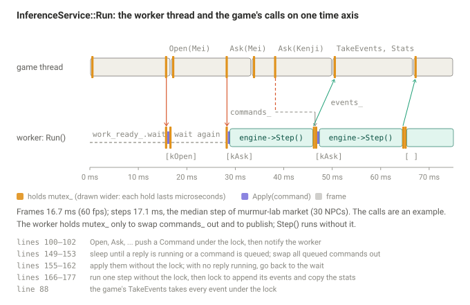

**Skim**
- the header: `InferenceEvent`, the public methods, and the four members "guarded by mutex_". Those are everything the two threads share.
- [`Ask`]({engine/inference_service.cpp|void InferenceService::Ask(ConversationId conversation, std::string message, std::optional<int> priority) {}): only [queues a command]({engine/inference_service.cpp|Enqueue({.kind = CommandKind::kAsk, .conversation = conversation, .message = std::move(message),}) and returns at once.

**Skip:** `Reconfigure` (chapter 41), the draft model and action grammar setup (Part IX), `ServiceKind`.

**Notice:** the worker holds the lock only to swap the commands out, never during a step. That's why [`Open`]({engine/inference_service.cpp|ConversationId InferenceService::Open(ConversationOptions options) {}) can return an id at once: the game gets the number now, and the conversation is created later, in order, before any `Ask` for it.

**Notice:** a failed command (a message too long for an NPC's memory, say) is [reported for its conversation]({engine/inference_service.cpp|Publish({.kind = InferenceEventKind::kError, .conversation = command.conversation, .text = error.what()});}) and the worker carries on. A failed load or step publishes `kStopped` and ends it.

**Notice:** `Run` owns the model and the engine as locals, [in that order]({engine/inference_service.cpp|std::optional<Engine> engine;}), so the engine is destroyed first and its [destructor]({engine/engine.cpp|Engine::~Engine() {}) can hand its pages back.

**Tests:** [inference_service_tests.cpp](../tests/inference_service_tests.cpp).

---

# Part VIII · Smaller numbers

Weights and cached keys and values can be stored in fewer bits: fewer bytes to read every step, more room for the NPCs' memories. This part goes back over chapters 15–23 for the FP8 and INT4 branches skipped there. [quantization.md](quantization.md) measures every format's speed, memory and quality.

## 37 Quantizing at load

★ · [engine/kernels/quantize.cu](../src/engine/kernels/quantize.cu) · [weight_matrix.cpp](../src/engine/weight_matrix.cpp) · [channel_importance.cpp](../src/engine/channel_importance.cpp) · builds on 20

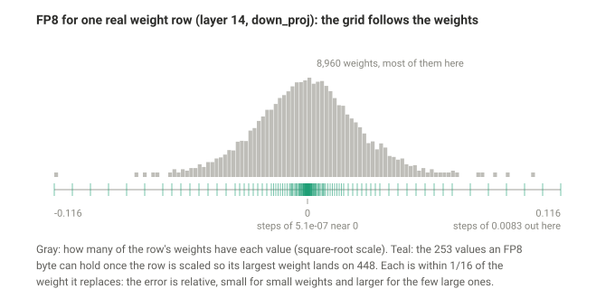

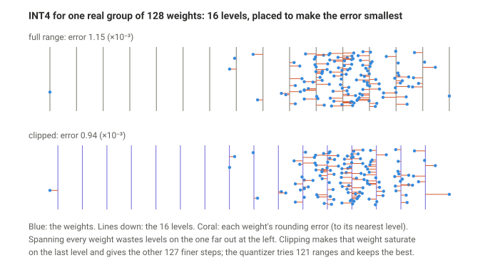

**Study**
- [`QuantizeToFp8Kernel`]({engine/kernels/quantize.cu|__global__ void QuantizeToFp8Kernel(const Bf16Bits* in, int cols, std::uint8_t* out, float* row_scales) {}): one block per row finds the largest magnitude, maps it to 448 (FP8's largest value) and rounds every weight.


**Skim**
- [`WeightFormat`]({engine/kernels/weight_view.cuh|enum class WeightFormat : std::uint8_t {}) again, all three lines now. FP8 is an 8-bit floating-point number, with one scale per row; INT4 keeps 16 evenly spaced levels per group of 128 weights, with the group's range beside them.
- the rest of [`FromBf16`]({engine/weight_matrix.cpp|WeightMatrix WeightMatrix::FromBf16(DeviceBuffer<std::uint8_t> bf16, int out_features, int in_features,}): the matrix arrives in BF16 and is converted on the GPU.
- [`QuantizeToInt4Kernel`]({engine/kernels/quantize.cu|__global__ void QuantizeToInt4Kernel(const Bf16Bits* in, int groups, int groups_per_row,}): one warp per group. It [tries 121 ranges]({engine/kernels/quantize.cu|for (int a = 0; a < kClipSteps; ++a) {}) and keeps the one with the smallest [importance-weighted error]({engine/kernels/quantize.cu|error += importance[i] * d * d;}).
- the comment above [`ChannelImportance`]({engine/channel_importance.hpp|class ChannelImportance {}): where the importance comes from. `murmur-lab calibrate` runs the original model over market dialogue while [`Linear::Apply` records]({engine/linear.cpp|statistics_->Add(weight, x, rows, options, stream_);}) every product's input.

**Skip:** `AccumulateInputSquaresKernel`, `QuantizeRowsToFp8Kernel` (chapter 39), `Save`/`Load`.

**Why:** a few input channels carry far larger values than the rest, so an error in their weights costs far more. Weighting by measured importance puts INT4's limited precision where errors cost the most; [quantization.md](quantization.md) shows the spike.

## 38 Packed weights, one row

[engine/kernels/matvec.cu](../src/engine/kernels/matvec.cu) · [weight_decode.cuh](../src/engine/kernels/weight_decode.cuh) · builds on 15, 37

**Skim**
- [`Packed8`]({engine/kernels/matvec.cu|struct Packed8;}): a load always brings 8 weights: 16 bytes of BF16, 8 of FP8, 4 of INT4. So every lane reads the same 8 activations whatever the format, and only `Dot8` differs.
- the [INT4 `Dot8`]({engine/kernels/matvec.cu|__device__ __forceinline__ float Dot8(unsigned w, float4 a, float4 b, std::uint32_t packed_range) {}) and [`NibbleToFloat`]({engine/kernels/weight_decode.cuh|__device__ __forceinline__ float NibbleToFloat(unsigned word, int i) {}): a 4-bit code becomes a float in two cheap instructions, and the group's scale and minimum apply once per 8 weights.
- [`RowsPerWarp`]({engine/kernels/matvec.cu|int RowsPerWarp(WeightFormat format, int rows, bool swiglu) {}): narrow formats give each warp more rows, so each activation value a lane loads is used with more weights. INT4 went from 46% to 62% of the bandwidth limit with that alone.

**Skip:** the FP8 `Dot8` (the same idea with a pair conversion).

## 39 Packed weights, many rows

[engine/kernels/gemm.cu](../src/engine/kernels/gemm.cu) · [blas.cpp](../src/engine/blas.cpp) · builds on 18, 37

**Skim**
- [`WeightPair`]({engine/kernels/gemm.cu|__device__ __forceinline__ unsigned WeightPair(const unsigned char* row, int k, __half2 group_scale,}): `GemmKernel` copies *packed* weights into shared memory and unpacks only the pair each thread's fragment needs.
- [`ReduceSplitsKernel`]({engine/kernels/gemm.cu|__global__ void ReduceSplitsKernel(const float* __restrict__ partials, int splits, int rows, Epilogue epilogue) {}): when the output is too small to give every SM a block, the long input dimension is split across blocks, and the partial sums are added in a fixed order.
- the FP8 tensor-core path, three calls: [`QuantizeRowsToFp8`]({engine/kernels/quantize.cu|void QuantizeRowsToFp8(const float* x, int rows, int width, const float* norm_weight, float epsilon, std::uint8_t* out,}) rounds the activations to FP8, [`Blas::LinearFp8`]({engine/blas.cpp|void Blas::LinearFp8(const std::uint8_t* x, const std::uint8_t* weight, float* y, int rows, int in_features,}) runs cuBLASLt's FP8 product, and [`FinishFp8Products`]({engine/kernels/gemm.cu|void FinishFp8Products(const float* products, int rows, const float* x_scales, const WeightView& weight, float* y,}) applies both scales.
- in linear.cpp, [`ApplyFp8TensorCores`]({engine/linear.cpp|void Linear::ApplyFp8TensorCores(const float* x, const WeightMatrix& weight, float* y, int rows,}), which chains them.

**Skip:** `PlanFp8` (cuBLASLt's setup) and the `Launch` templates.

**Why:** unpacking inside the kernel keeps the memory saving. Expanding the matrix back to 16 bits first would throw it away.

## 40 A smaller KV cache

[engine/kernels/rope.cu](../src/engine/kernels/rope.cu) · [paged_kv.cuh](../src/engine/kernels/paged_kv.cuh) · [kv_cache.cpp](../src/engine/kv_cache.cpp) · builds on 16, 23

**Skim**
- [`KvFormat`]({engine/kernels/paged_kv.cuh|enum class KvFormat : std::uint8_t {}).
- [`StoreHead`]({engine/kernels/rope.cu|__device__ void StoreHead(const float* staged, int head_dim, void* data, float* scales, std::size_t cache_row,}), its FP8 branch: the head's largest value sets a scale stored beside it. Both attention kernels read it back with [`LoadKv`]({engine/kernels/paged_kv.cuh|__device__ __forceinline__ float LoadKv(const void* data, const float* scales, std::size_t row, int kv_width,}).
- [`LayerKvFormat`]({engine/kv_cache.cpp|KvFormat LayerKvFormat(KvFormat format, int layer) {}): in FP8 mode the first two layers keep BF16.

**Why:** with long conversations the cache, not the weights, is most of what a step reads, and FP8 halves it. The first two layers' keys have outliers too large for FP8 to keep ([quantization.md](quantization.md)).

**Tests:** [quantization_tests.cpp](../tests/quantization_tests.cpp): rounding bounds, importance, every format through `MatVec` and `GemmF16`, the cache layout.

## 41 Switching live

[game/main.cpp](../src/game/main.cpp) · [inference_service.cpp](../src/engine/inference_service.cpp) · [engine.cpp](../src/engine/engine.cpp) · builds on 36, 37, 40

Press Q in the game to cycle the weight format.

**Skim**, following the call:
- the [key handler]({game/main.cpp|engine.SetFormats(NextWeights(stats.weight_format), stats.kv_format);}) asks the service for new formats;
- [`InferenceService::Reconfigure`]({engine/inference_service.cpp|void InferenceService::Reconfigure(Engine& engine, const Command& command) {}) loads the weights in the new format and gives the KV cache [whatever the budget leaves]({engine/model_loader.cpp|std::size_t KvBytesWithin(std::size_t memory_budget, const ModelWeights& weights) {});
- [`Engine::Reconfigure`]({engine/engine.cpp|void Engine::Reconfigure(ModelWeights weights, std::size_t kv_bytes, KvFormat kv_format) {}) evicts every conversation (they recompute their history when they next run), then calls [`ReplaceWeights`]({engine/transformer.cpp|void Transformer::ReplaceWeights(ModelWeights weights) {}) and [`ResizeKvCache`]({engine/transformer.cpp|void Transformer::ResizeKvCache(std::size_t bytes, KvFormat format) {}).

**Notice:** the new weights load while the old ones are still on the GPU, so for a moment both are resident; the KV cache, by contrast, is freed before its replacement is allocated.

**Why:** the weights and the cache share one 3.75 GB budget, so every byte the weights save becomes room for the NPCs' memories.

## 42 Measuring the loss

[lab/quality.cpp](../src/lab/quality.cpp) · [logit_comparison.cu](../src/lab/logit_comparison.cu) · builds on 25, 37

**Skim**
- [`RunQuality`]({lab/quality.cpp|int RunQuality(Args args) {}): one model per format on the GPU. For every window of text it runs the original (BF16, exact math), [captures every row's logits]({lab/quality.cpp|class LogitsCapture : public ForwardObserver {}), then runs each candidate.
- [`CompareLogitsKernel`]({lab/logit_comparison.cu|__global__ void CompareLogitsKernel(const float* reference, const float* candidate, int row_stride, int vocab,}): per position, the KL divergence, each model's surprise at the actual next token, and whether both rank the same token first.

**Skip:** argument parsing and the report printing.

**Why:** two formats can write the same sentence while one is far less sure of it. Comparing the whole next-token distribution at every position catches a loss before it shows in the text.

---

# Part IX · NPCs that act

Every NPC reply ends with an action the market carries out, like `quest(noodles, Kenji)`. A grammar restricts the model to actions the game can parse. Then a small draft model guesses ahead to save big-model steps.


## 43 Grammar to automaton

[engine/grammar.hpp](../src/engine/grammar.hpp) · [grammar.cpp](../src/engine/grammar.cpp) · builds on nothing

**Skim**
- the comment above [`ByteAutomaton`]({engine/grammar.hpp|class ByteAutomaton {}): the grammar language, with an example.
- [`ByteAutomaton::Compile`]({engine/grammar.cpp|ByteAutomaton ByteAutomaton::Compile(std::string_view grammar) {}), three classic stages. A [`Parser`]({engine/grammar.cpp|class Parser {}) turns each rule into a tree. An [`NfaBuilder`]({engine/grammar.cpp|class NfaBuilder {}) turns the tree into a small machine where a byte may lead to several states at once. [Subset construction]({engine/grammar.cpp|const auto intern = [&](std::vector<int> set) {}) makes that deterministic: every *set* of states becomes one state.
- [`Walk`]({engine/grammar.cpp|int ByteAutomaton::Walk(int state, std::string_view bytes) const {}): check any text byte by byte.

**Skip:** the bodies of `Parser` and `NfaBuilder` beyond their comments, and `Closure`.

**Notice:** a rule that refers to itself is [rejected]({engine/grammar.cpp|Fail("rule \"" + node.text + "\" refers to itself: only regular grammars are supported");}). Without recursion the language stays regular, which is exactly what a finite table of states can check.

## 44 Automaton to tokens

[engine/grammar.cpp](../src/engine/grammar.cpp) · builds on 5, 43

The model writes tokens, not bytes, and one token can span several parts of the grammar at once (` call(K`: a verb, a parenthesis and the start of a name).

**Skim**
- the comment above [`TokenGrammar`]({engine/grammar.hpp|class TokenGrammar {}).
- [the constructor]({engine/grammar.cpp|TokenGrammar::TokenGrammar(const ByteAutomaton& automaton, const Tokenizer& tokenizer, TokenId end_token)}): [buckets every token by its first byte]({engine/grammar.cpp|std::array<std::vector<TokenId>, 256> by_first_byte;}), [walks each candidate's bytes]({engine/grammar.cpp|const int end = automaton.Walk(s, tokenizer.TokenBytes(id));}) from every state, uploads one [bitmask per state]({engine/grammar.cpp|masks[static_cast<std::size_t>(s) * mask_words_ + id / 32] |= 1u << (id % 32);}), and finds the [bytes the grammar fixes]({engine/grammar.cpp|std::string ForcedBytes(const ByteAutomaton& automaton, int state) {}).

**Skip:** `Next` (a binary search) and `DeviceMask`.

**Why:** doing the work once at load, 30 ms for 913 states, makes each step's check one bit per token.

**Tests:** [grammar_tests.cpp](../tests/grammar_tests.cpp): automata, token masks, forced text.

## 45 Speaking, then acting

★ · [engine/engine.cpp](../src/engine/engine.cpp) · [kernels/sampling.cu](../src/engine/kernels/sampling.cu) · builds on 19, 35, 44

A reply has two phases, kept in the conversation's `phase`.


**Study**
- **Speaking.** [`SamplingFor`]({engine/engine.cpp|SamplingRequest Engine::SamplingFor(const Conversation& c, double draw, std::span<const TokenId> penalty_ids) const {}) gives the conversation's rows the [speech mask]({engine/engine.cpp|request.allowed = speech_mask_.Data();}): no line breaks, no `(`. The sampler [skips masked tokens]({engine/kernels/sampling.cu|if (params.allowed != nullptr && ((params.allowed[i >> 5] >> (i & 31)) & 1u) == 0) {}) as it collects candidates.
- **Acting.** Rows now carry the [grammar's mask]({engine/engine.cpp|request.allowed = actions_.grammar->DeviceMask(c.grammar_state);}). [`AcceptAction`]({engine/engine.cpp|void Engine::AcceptAction(Conversation& c, TokenId token, std::vector<EngineEvent>& events) {}) advances the grammar, and [`WriteForced`]({engine/engine.cpp|void Engine::WriteForced(Conversation& c, std::vector<EngineEvent>& events) {}) appends the tokens the grammar now leaves no choice about, without running the model: after ` call(K` comes `enji)`. [`AppendActionToken`]({engine/engine.cpp|bool Engine::AppendActionToken(Conversation& c, TokenId token, int next_state, bool forced,}) abandons an action that reaches the 48 tokens kept for it.


**Skim**
- At end of turn, `Accept` calls [`StartAction`]({engine/engine.cpp|void Engine::StartAction(Conversation& c, std::vector<EngineEvent>& events) {}): the lead-in `"\nACTION:"` is appended and the grammar's start state takes over.
- [`Finish`]({engine/engine.cpp|if (c.phase == ReplyPhase::kActed) {   // a cancelled or abandoned action doesn't count}) emits the action as a `kAction` event, with a [byte mask of who wrote what]({engine/engine.cpp|c.action_forced.append(bytes.size(), forced ? 1 : 0);}).

**Notice:** forced tokens are only appended, not run. They go through the model with the next step, together with its next choice, as a short prompt chunk.

**Why:** masked tokens are removed before the draw, so the model chooses freely among what's allowed and can't write an invalid action. Where the grammar leaves no choice the model isn't asked at all, which is about half of an action's tokens ([actions_and_speculation.md](actions_and_speculation.md)).

## 46 Guess and check

★ · [engine/speculator.hpp](../src/engine/speculator.hpp) · [speculator.cpp](../src/engine/speculator.cpp) · [engine.cpp](../src/engine/engine.cpp) · builds on 25, 32

A 0.5B model of the same family guesses a few tokens ahead; the big model checks all the guesses in one pass.


**Study**
- [`Verify`]({engine/engine.cpp|void Engine::Verify(Conversation& c, int drafted, std::span<const TokenId> checked, std::vector<EngineEvent>& events) {}): keeps guesses [while they match]({engine/engine.cpp|while (accepted < drafted && checked[accepted] == c.step_tokens[1 + accepted]) {}) the big model's own choice, takes the big model's token at the first mismatch, and [truncates]({engine/engine.cpp|Cache().Truncate(c.kv, c.kv.length);}) the cache past it.


**Skim**
- the comment above [`Speculator`]({engine/speculator.hpp|class Speculator {}).
- [`Engine::Speculate`]({engine/engine.cpp|void Engine::Speculate(std::vector<Planned>& plan) {}): only while [few conversations decode]({engine/engine.cpp|if (decoding > options_.max_speculative_batch) {}). [`Speculator::Propose`]({engine/speculator.cpp|std::vector<std::vector<TokenId>> Speculator::Propose(std::span<const DraftRequest> requests) {}) guesses with the same settings and the same [random draws]({engine/engine.cpp|std::span<const double> Engine::PeekDraws(Conversation& c, int count) {}) the big model will use.
- each guess is staged as its own [decode row]({engine/transformer.cpp|if (count == 1 || entries[i].decode_each_token) {}) that sees exactly the context before it.

**Skip:** `Speculator::Prepare` and `Run` (keeping the draft model's own cache in step).

**Notice:** every kept token still goes through `Accept` with its own draw, so the reply is the one plain decoding would have written.

**Why:** when most guesses are right, a reply needs fewer big-model steps. Here it barely pays (1.01× at best): the big model's step is already short, and batching shares it anyway ([actions_and_speculation.md](actions_and_speculation.md)).

**Tests:** [speculative_tests.cpp](../tests/speculative_tests.cpp): identical greedy replies, sampled ones following the same draws.

---

# Part X · The game

The game only talks to `InferenceService` (chapter 36). It draws with raylib and never touches the GPU work directly.

## 47 The action language

[game/action_language.hpp](../src/game/action_language.hpp) · [action_language.cpp](../src/game/action_language.cpp) · [personas.hpp](../src/game/personas.hpp) · builds on nothing

**Skim**
- the header: the comment lists every action, then the places, the items, and `Action`.
- [`Grammar`]({game/action_language.cpp|std::string Grammar() {}): the grammar text of chapter 43, built from those lists. [`Rules`]({game/action_language.cpp|std::string Rules() {}): what every NPC is told about it, placed [right after the lore]({game/personas.hpp|prompt += rules;}) so all 32 prompts share it, and its cached pages.
- [`Parse`]({game/action_language.cpp|std::optional<Action> Parse(std::string_view sentence) {}): reads a sentence back into an `Action`.

**Skip:** the helpers at the top, and the persona texts in personas.hpp.

**Notice:** one list feeds the grammar, the prompt and the parser, so they can't drift apart. The street even [checks at compile time]({game/street.cpp|static_assert(LabelsMatchPlaces());}) that its signs are the grammar's places.

**Tests:** [action_language_tests.cpp](../tests/action_language_tests.cpp): the parser rejects exactly what the grammar rejects.

## 48 The street and its light

[game/street.cpp](../src/game/street.cpp) · [post_fx.cpp](../src/game/post_fx.cpp) · builds on nothing

**Skim**
- [`DrawNeonSign`]({game/street.cpp|void DrawNeonSign(const Storefront& storefront, float level) {}) (a board, a tube and hotter letters) and [`NeonLevel`]({game/street.cpp|float NeonLevel(std::size_t index, float time) {}) (each sign flickers at its own times).
- [`PostFx::EndScene`]({game/post_fx.cpp|void PostFx::EndScene(float time) {}): the street is drawn into a texture, then through one shader: [reflections]({game/post_fx.cpp|// Wet street: the storefronts mirrored at each curb, rippling with the}) mirrored at the nearer curb, and [bloom]({game/post_fx.cpp|// Bloom: what stays bright after blurring glows.}) from three mip levels.

**Skip:** `Rain`, the storefront table, `MovePlayer`.

**Why:** the whole look is one extra pass over one texture, so the street costs the GPU almost nothing next to the model it shares the GPU with.

## 49 The market

[game/market.hpp](../src/game/market.hpp) · [market.cpp](../src/game/market.cpp) · builds on 36, 47, 48

**Skim**
- [`Npc`]({game/market.hpp|struct Npc {}): each field commented. `replying`, `reply_for_player` and `player_waiting` are the ones the rest of the code checks most.
- [the constructor]({game/market.cpp|Market::Market(InferenceService& service) : service_(&service), hacks_(Storefronts().size()) {}): one conversation per NPC, with the city lore plus its persona as the [system prompt]({game/market.cpp|options.system_prompt = personas::MarketSystemPrompt(cast[i], rules);}).
- [`Market::Update`]({game/market.cpp|void Market::Update(float delta_time, bool engine_ready, const Npc* talking_to_player) {}) and [`Chatter`]({game/market.cpp|void Market::Chatter(Npc& npc) {}): idle NPCs call out on a timer, which keeps the engine busy.
- [`PlayerSays`]({game/market.cpp|void Market::PlayerSays(Npc& npc, std::string message) {}): if the NPC is mid-sentence, that line is [cancelled]({game/market.cpp|service_->Cancel(npc.conversation);\n        pending_ = PendingMessage{ &npc, std::move(message) };}) and the message waits; otherwise it goes out at once with [the player's priority]({game/market.cpp|service_->Ask(npc.conversation, std::move(message), kPlayerPriority);}).
- [`OnEvent`]({game/market.cpp|void Market::OnEvent(const InferenceEvent& event) {}): text [grows the NPC's line]({game/market.cpp|npc->line += event.text;}); an [action]({game/market.cpp|case InferenceEventKind::kAction:}) goes to [`Act`]({game/market.cpp|bool Market::Act(Npc& npc, const actions::Action& action) {}), which carries it out.

**Skip:** `Move`, `Buy`, the drawing functions, and the find helpers.

**Notice:** `give`, `sell` and `quest` only count when the NPC was talking to the player, and a held-back message [goes out]({game/market.cpp|PlayerSays(*npc, std::move(message.text));}) when the reply it waited for finishes.

**Tests:** [market_tests.cpp](../tests/market_tests.cpp).

## 50 Talking and the X-ray

[game/dialogue.cpp](../src/game/dialogue.cpp) · [text_layout.cpp](../src/game/text_layout.cpp) · [hud.cpp](../src/game/hud.cpp) · builds on 49

**Skim**
- [`Dialogue::Update`]({game/dialogue.cpp|void Dialogue::Update(Vector2 player, float delta_time, bool engine_ready) {}) (finds the NPC the player is next to), [`Say`]({game/dialogue.cpp|void Dialogue::Say(Npc& npc, std::string message) {}) and [`DrawSpeechBubble`]({game/dialogue.cpp|void Dialogue::DrawSpeechBubble() const {}).
- [`WrapText`]({game/text_layout.cpp|std::vector<std::string_view> WrapText(std::string_view text, float max_width, const TextMeasure& width) {}): returns each line as a view into the original text, not a copy.
- [`Engine::Stats`]({engine/engine.cpp|EngineStats Engine::Stats() const {}) builds a snapshot after every step, and [`Hud::DrawXRay`]({game/hud.cpp|void Hud::DrawXRay(const Market& market, const EngineStats& stats) const {}) draws it: one square per page, [coloured by the NPC that owns it]({game/hud.cpp|Color PageColor(const Market& market, ConversationId owner) {}).

**Skip:** the rest of hud.cpp (status lines, notices).

**Tests:** [text_layout_tests.cpp](../tests/text_layout_tests.cpp).

## 51 The frame loop

[game/main.cpp](../src/game/main.cpp) · builds on 36, 49, 50

**Skim** [`main`]({game/main.cpp|int main(int argc, char** argv) {}) from top to bottom. It creates the [`InferenceService`]({game/main.cpp|InferenceService engine(std::move(engine_options));}) and the [`Market`]({game/main.cpp|Market market(engine);}); then every frame it [drains the engine's events]({game/main.cpp|for (const InferenceEvent& event : engine.TakeEvents()) {}), updates the market and the dialogue, and draws the street [into the post-processing texture]({game/main.cpp|post_fx.BeginScene();}) and everything else on top.

**Skip:** `ReadCommandLine`, `MoveToSecondMonitor`, and the demo branches ([demo.cpp](../src/game/demo.cpp)).

**Notice:** the game never calls the model and never waits. Text crosses from the worker to the game only as events, picked up once per frame.

---

# Part XI · All together

## 52 One message, end to end

★ · builds on the ★ chapters above

Now follow one message through the whole system. The player walks up to Mei and types *"what's good tonight?"* while the other 31 NPCs chatter.


1. **Game thread.** `Dialogue::Say` → `Market::PlayerSays` → `InferenceService::Ask` queues a command and returns (chapters 49, 36).
2. **Worker thread.** `Run` swaps the command out, and `Engine::Send` appends Mei's turn: the chat format and the tokenizer turn it into ids (31, 6, 5).
3. **Next step.** `Plan` puts the player's prompt first and reuses the lore's cached pages; `MakeRoom` finds pages for the rest (33, 9, 34).
4. **GPU.** `Transformer::Step` runs Mei's prompt chunk in the same forward pass as every chattering NPC's decode row: 28 layers of chapter 25's six calls (25, 15, 16, 28, 30).
5. **Sampling.** One launch picks every conversation's next token; only the ids come back (26, 19).
6. **Text out.** `Accept` decodes Mei's token and emits a `kText` event; the next frame appends it to her speech bubble (35, 49, 50).
7. **Repeat** from step 3, one token per step, until end of turn. Then her action is written under the grammar, and `Finish` closes the turn (45, 35).

## 53 The same workload everywhere

[lab/compare_benchmark.cpp](../src/lab/compare_benchmark.cpp) · [bench/compare](../bench/compare) · builds on 31

**Skim**
- [`MakeWorkload`]({lab/compare_benchmark.cpp|nlohmann::json MakeWorkload() {}): the 64 requests every engine answers ([workload.json](../bench/compare/workload.json)). Each starts with its own tag, so no engine can reuse another's cached prompt.
- [`RunBatch`]({lab/compare_benchmark.cpp|Batch RunBatch(Transformer& model, const Tokenizer& tokenizer,}): a batch through the full engine, after [forgetting every cached prefix]({lab/compare_benchmark.cpp|model.KvCache().ForgetCachedPrefixes();}).
- [run_vllm.py](../bench/compare/run_vllm.py) and [run_ollama.py](../bench/compare/run_ollama.py): the same measures for vLLM and llama.cpp, from their own APIs.

**Notice:** the decode measure, [(tokens − 1) / time after the first]({lab/compare_benchmark.cpp|decode.push_back((reply.reply_tokens - 1) / (reply.decode_ms / 1e3));}), is computed for the other engines as (256-token time − first-token time) / 255: the same quantity from outside.

**Why:** engines are only comparable on the same model, prompts, reply lengths and measures. [comparison.md](comparison.md) has the results.

## 54 Watch it run

To step through the code in Visual Studio, use the **x64 Debug** preset (Release optimizes variables away).

**One conversation through the engine.** Choose `murmur-tests.exe` as the startup item and set its arguments (**Debug and Launch Settings**) to `--gtest_filter=EngineTest.OneConversationReproducesTheReferenceReply`. Then set breakpoints at:

| Breakpoint | Watch |
| --- | --- |
| [engine.cpp: Plan's sort]({engine/engine.cpp|std::ranges::sort(runnable, [](const Conversation* a, const Conversation* b) {}) | `runnable`: who wants to run this step |
| [engine.cpp: the forward pass]({engine/engine.cpp|transformer_->Step(entries);}) | `entries`: the first step runs the whole prompt, every later one a single token |
| [transformer.cpp: the cache row]({engine/transformer.cpp|host[layout_.row_cache + row] = (sequence.pages[position >> page_shift_] << page_shift_) | (position & mask);}) | where each token's key and value will go |
| [engine.cpp: Accept]({engine/engine.cpp|void Engine::Accept(Conversation& c, TokenId token, std::vector<EngineEvent>& events, bool drafted) {}) | `token` on each step; the reply grows one piece at a time |

**Many at once.** The same with `--gtest_filter=EngineTest.ConversationsJoinAndLeaveTheBatchAtAnyStep`: watch `plan` grow from one conversation to three.

**Without a debugger.** `murmur-lab schedule` prints every step of a five-conversation run, and `murmur-lab chat` talks to Mei in the terminal through chapter 27's `ChatSession`.

**Inside a kernel.** The Visual Studio debugger stops on the CPU only; GPU code needs Nsight. A simpler path is the kernel tests, which run each kernel on small inputs against a CPU version you can read.

## 55 Where the tests are

Each chapter links its tests. They come as two programs. `murmur-host-tests` needs no GPU and builds without CUDA (Part I and argument parsing); `murmur-tests` holds the rest. Tests that need the model find it where the game does (`models/` or `$MURMUR_MODEL_DIR`) and skip themselves without it. Timing budgets are recorded on every run but only fail it with `MURMUR_TIMING_TESTS=1`, so a busy machine can't fail a correct build.

How the reference data is made, and how close the engine comes to it: [correctness.md](correctness.md).

---

## Running it

Build once, from any terminal in the repository root (Cursor, VS Code, Windows Terminal):

```
.\build.cmd
```

It loads the MSVC compiler into the shell, then runs `cmake --preset x64-release` and `cmake --build`. `.\build.cmd x64-debug -Test` builds Debug and runs the tests; `.\build.cmd -Run <name>` builds one program and starts it, with the names in the first column below. In Cursor the terminal already has the compiler loaded, so plain `cmake --preset x64-release` and `cmake --build --preset x64-release` work too. In Visual Studio: **File > Open > Folder**, preset **x64 Release**.

Then, from the repository root (so the programs find `models/`):

| `-Run` | Command | What you see |
| --- | --- | --- |
| `game` | `out\build\x64-release\murmur.exe` | the market: WASD to walk, E next to any stall to talk, Enter to send, Tab for the X-ray, Q to cycle the weights (BF16, FP8, INT4), K to switch the KV cache (BF16, FP8), B to buy what an NPC offers, G to let the draft model guess ahead. `--weights` and `--kv` pick the starting formats |
| `demo` | `out\build\x64-release\murmur.exe --demo "What's good tonight?" --warmup 15 --xray` | a scripted run: the market chatters for 15 s, then you ask Mei; prints her reply, the frame rate and her time to first word |
| `schedule` | `out\build\x64-release\murmur-lab.exe schedule` | continuous batching, step by step |
| `batch` | `out\build\x64-release\murmur-lab.exe batch` | throughput against latency, 1 to 64 conversations |
| `market` | `out\build\x64-release\murmur-lab.exe market` | 30 NPCs talking non-stop: the player's time to first token, then a leak check |
| `chat` | `out\build\x64-release\murmur-lab.exe chat` | talk to Mei in the terminal |
| `tests` | `out\build\x64-release\murmur-host-tests.exe`, then `murmur-tests.exe` | every test (the model-dependent ones skip themselves without the model) |
| `calibrate` | `out\build\x64-release\murmur-lab.exe calibrate` | measures channel importance for INT4 (once, 30 s; saved next to the model) |
| `quality` | `out\build\x64-release\murmur-lab.exe quality` | how much each format loses against the original model |
| `actions` | `out\build\x64-release\murmur-lab.exe actions` | NPC actions with and without the grammar: how many parse, who wrote which tokens |
| `compare` | `out\build\x64-release\murmur-lab.exe compare --weights fp8` | Murmur on the comparison workload: first token, decode, throughput at 1–64 |
| `speculative` | `out\build\x64-release\murmur-lab.exe speculative` | the draft model guessing ahead: speed-up and kept guesses for 1 to 8 guesses per step |

`decode`, `batch` and `market` take `--weights bf16|fp8|int4`; `market` also takes `--kv` and `--math`.
