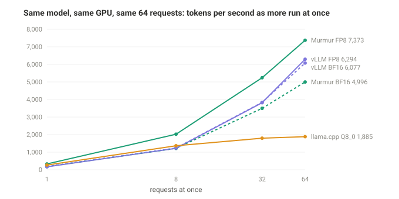
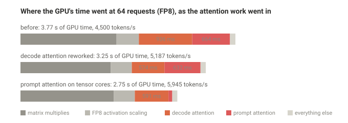
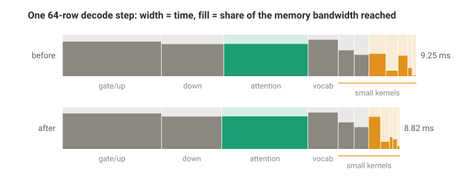
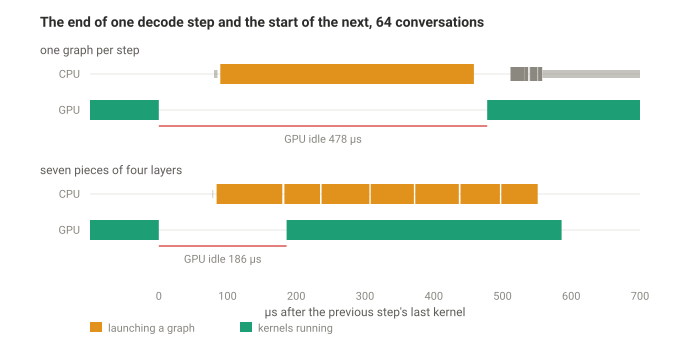

# Murmur against vLLM and llama.cpp

The same model, GPU and workload through three engines, the profile that showed where Murmur lost, the two attention kernels rewritten because of it, and the result. The code is walked through in [the code tour](CODE_TOUR.md) (chapters 28, 30 and 53); how to reproduce it in [bench/compare](../bench/compare/README.md).

## Setup

| | |
| --- | --- |
| GPU | RTX 4080 SUPER (16 GB, 736 GB/s), Windows 11, driver 616.56 |
| Model | Qwen2.5-1.5B-Instruct, the same safetensors for every engine |
| Murmur | this repository, Release build, `murmur-lab compare` |
| vLLM | 0.28.0, PyTorch 2.13 (CUDA 13.0), offline `LLM.chat`, CUDA graphs on, prefix caching off, under WSL2 |
| llama.cpp | as served by Ollama 0.40.13 (64 parallel slots, flash attention on); GGUF written from the same safetensors by [to_gguf.py](../bench/compare/to_gguf.py) |
| Formats | Murmur BF16 / FP8 / INT4 weights (BF16 KV cache); vLLM BF16 / FP8 (its dynamic per-tensor FP8); llama.cpp F16 / Q8_0 |

**Workload.** 64 requests: a system prompt (a unique tag, then the market's city lore; 377 tokens with the chat template, counted by all three engines) and a request for a long story about one of the NPCs. Greedy, up to 256 tokens. The unique tag keeps any engine from reusing another request's cached prompt.

**Measures**, from each engine's API: time to first token (1-token request, median of 5); decode (256-token request: (time − first-token time) / 255, median of 5); throughput (1, 8, 32 or 64 requests at once; generated tokens over wall time). All engines ran back to back on a quiet desktop; Murmur, run again at the end, was within 1.5% of its first run, and a second vLLM run within 2%.

**Same answers.** The six 16-bit and 8-bit runs write the same greedy words for the first request until one token, where they split between " memory" (vLLM) and " augment" (Murmur, llama.cpp). The FP32 reference model gives those logits of 19.6442 and 19.6375 ([near_tie.json](../bench/compare/results/near_tie.json)), a near-tie that each engine's rounding breaks its own way. Murmur INT4 departs earlier ("Priya had always been a bit of a loner"), the cost of 4-bit weights.

## Results

| | First token | 1 at once (decode) | 8 | 32 | 64 |
| --- | --- | --- | --- | --- | --- |
| **Murmur FP8** | **9.9 ms** | **329 tokens/s** | **2,023** | **5,240** | **7,373** |
| vLLM FP8 | 18.0 ms | 166 | 1,221 | 3,817 | 6,294 |
| Murmur INT4 | 18.4 ms | 463 | 2,470 | 5,300 | 5,625 |
| Murmur BF16 | 16.9 ms | 187 | 1,221 | 3,496 | 4,996 |
| vLLM BF16 | 17.3 ms | 183 | 1,237 | 3,835 | 6,077 |
| llama.cpp Q8_0 | 16.0 ms | 275 | 1,366 | 1,797 | 1,885 |
| llama.cpp F16 | 18.1 ms | 174 | 929 | 1,225 | 1,769 |

Raw numbers: [bench/compare/results](../bench/compare/results).

- **Where Murmur wins:** FP8, at every concurrency. Against vLLM FP8 the first token arrives 45% sooner, one conversation decodes twice as fast (vLLM's FP8 is slower than its own BF16 there, 166 against 183), and 64 at once is 17% ahead. INT4 is the fastest single conversation of all (463 tokens/s), at INT4's quality cost ([quantization.md](quantization.md)).
- **Level:** BF16 for one conversation and 8 at once.
- **Where Murmur loses:** BF16 from 32 requests on, 82% of vLLM at 64. With short prompts it is 90% ([short_*.json](../bench/compare/results)), so about half the gap grows with the prompt's length and half is in decoding. Hardware counters and the timeline found part of the decoding share ([below](#where-the-gpu-waited)): +5% at 64, included in this table.
- llama.cpp, as Ollama serves it, is close for one conversation and scales least with concurrency.

## What the profile showed

Nsight Systems, the 64-request workload with FP8 weights, GPU kernel time by kind ([profile_64.json](diagrams/data/profile_64.json)):

| | Matrix multiplies | FP8 activation scaling | Decode attention | Prompt attention | Total | Tokens/s |
| --- | --- | --- | --- | --- | --- | --- |
| Before | 1,687 ms | 392 | 936 | 664 | 3.77 s | 4,500 |
| Decode attention reworked | 1,582 | 372 | 574 | 633 | 3.25 s | 5,187 |
| Prompt attention on tensor cores | 1,636 | 372 | 591 | 66 | 2.75 s | 5,945 |

**Decode attention** must read every cached key and value once; at 64 conversations that's about 0.9 GB per step, 1.25 ms at full bandwidth, and it took 3.4 ms. It cut each sequence into up to 128 slices of 16 keys, which suits one conversation but not 64, where every slice wrote a partial result 38% the size of what it read. It now uses fixed 64-key slices (partials 10% of the reads), 16-byte loads, unrolled passes so loads overlap, a warp per head for the softmax and shuffles to sum lanes. Fixed-size slices also keep it batch-invariant, which speculative decoding depends on (a batch-sized first version broke `SampledRepliesFollowTheSameDraws`).

**Prompt attention** gave every (head, row) its own block re-reading every visible key, on CUDA cores: about 785 GFLOP at 1.2 TFLOPS. It is now FlashAttention-2 style: 64 query rows of one head per block, key and value tiles of 64 loaded once into shared memory as FP16, S = Q·Kᵀ and O += P·V with `mma.sync`, online softmax in registers, P passed from the S accumulators into the next MMA's fragments. A 64-row tile may span two prompts; the kernel walks each run of one prompt's rows separately. Quality as served is unchanged (BF16 mean KL 0.0002 against the original model, perplexity 29.80); a 512-token prompt went from 28.9 to 15.5 ms (FP8).

## Where the GPU waited

With GPU performance counters enabled, Nsight Compute measured one 64-row BF16 decode step kernel by kernel ([step_kernels.json](diagrams/data/step_kernels.json)); width is time, fill is the share of the memory bandwidth reached:

The large multiplies (gate/up and down), decode attention and the vocabulary projection run at 77–88% of the bandwidth; the qkv and output projections, small enough that cuBLAS picks other kernels for them, at 51–64%. The small kernels did not: SwiGLU, RMSNorm and the bias ran one block per row (64 blocks for 80 SMs, each walking its row one load at a time), and a separate pass converted SwiGLU's output to BF16. They now stride over all rows, RMSNorm keeps its row in registers, and SwiGLU writes the BF16 copy itself: 9.25 → 8.82 ms of kernels per step.

The timeline of the running engine (Nsight Systems) showed the rest: the GPU idle a median 0.48 ms before each step ([launch_lanes](diagrams/data/launch_gap.json)).

Launching the step's recorded graph took the CPU ~340 µs (about 1 µs per kernel), and the GPU started only once it returned; Windows' WDDM driver also batches submissions until forced. The step is now recorded as seven graphs of four layers, each followed by a stream query that hands it to the GPU: the GPU starts after the first piece, and the median gap is 186 µs. And because the batch shrinks one reply at a time, a new graph was recorded 51 times during the run (188 ms, GPU idle); graphs for every batch size are now recorded at startup, as vLLM does.

| 64 requests at once, tokens/s | before | after | |
| --- | --- | --- | --- |
| Murmur BF16 | 4,495 | 4,719 | +5.0% |
| Murmur FP8 | 6,676 | 6,929 | +3.8% |

Old and new builds alternated three times on the same workload (averages), on a busy desktop: the results table above, from a quiet one, is higher again. Only same-session comparisons are meaningful.

## Caveats

- On Windows the desktop's own rendering shares the GPU: a video playing in a browser moved every engine's results by up to 30%. These are from a quiet desktop.
- vLLM ran under WSL2, a thin virtualization layer over the same GPU; native Linux might be a few percent faster.
- llama.cpp's numbers include Ollama's server; llama.cpp's own `llama-server` or `llama-bench` may batch differently.
- This is one workload: medium prompts, greedy, unique prefixes. With shared prefixes (the market's usual case) Murmur and vLLM both reuse cached prompts; this comparison turns that off on purpose.
- The two FP8s scale differently (vLLM's online FP8 uses per-tensor scales, Murmur's a scale per row), so their quality differs a little; Murmur's is measured in [quantization.md](quantization.md).
