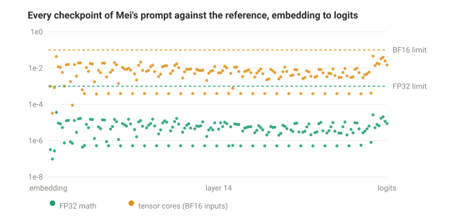

# Checking the engine against a reference

How Murmur shows that its from-scratch kernels compute the same model as the standard implementation, and what is checked when the engine trades exactness for speed.

**Setup:** Qwen2.5-1.5B-Instruct, RTX 4080 SUPER, Release build. The reference is the same model run by Hugging Face Transformers in FP32 on the CPU ([dump_reference.py](../reference/dump_reference.py)).

## The answer key

`reference/dump_reference.py` runs two prompts through the reference model and saves, with forward hooks, every intermediate tensor the engine reimplements: the embedding, ten tensors per layer (the norms, q, k and v, attention's weighted mix of values, the attention and MLP outputs, the MLP activation, the layer output), the final norm and the logits. That's 283 tensors per prompt, plus the greedy continuation (32 tokens) and the token ids of 17 tokenizer cases.

The two prompts are a plain sentence ("The capital of France is") and Mei's chat prompt (a system prompt, a question, the chat template).

## Layer by layer

The engine reports its own intermediate tensors to an observer, which compares each with the reference's tensor of the same name. Fused kernels never write some of them (the norms run inside the matrix products, the MLP's output is added straight into the layer output), so the engine reports 170 per prompt: the embedding, the logits, and per layer q, k, v, the attention mix, the MLP activation and the layer output.

The error of a checkpoint is the largest absolute difference divided by the largest reference magnitude: scale-free, so one limit works for every tensor.



| Math | Limit | Worst measured | Where |
| --- | --- | --- | --- |
| FP32 (the reference tests' path) | 10⁻³ | 3.6 × 10⁻⁵ | layer 0's attention mix, chat prompt |
| Tensor cores, FP16 inputs | 10⁻¹ | 1.7 × 10⁻² | layer 0's attention mix, chat prompt |
| Tensor cores, BF16 inputs (cuBLAS) | 10⁻¹ | 4.6 × 10⁻² | layer 26's output, chat prompt |

Data: [reference_errors.json](diagrams/data/reference_errors.json), every checkpoint of both prompts.

- **The FP32 path matches to rounding.** FP32 sums in a different order than PyTorch's drift by about 10⁻⁵; a bug (a wrong index, a missing scale) shows up as an error near 1 from the broken layer on. The limit sits 28× above the worst case and far below any bug.
- **Errors don't pile up.** Both bands stay flat from the first layer to the last, so rounding doesn't compound over the 28 layers.
- **Tensor cores round every activation to 16 bits** before the matrix products of prompt rows and batched decoding. That costs two orders of magnitude of error (the model carries a few very large activations, and BF16 keeps only 8 bits of mantissa), so those paths have their own limit, and the test also requires the predicted next token to be unchanged.

## Token by token

- **Greedy decoding** must produce exactly the reference's 32 tokens for both prompts, on the FP32 path. The first differing token fails the test with its position.
- **The tokenizer** must produce exactly Hugging Face's token ids for 17 cases: one per branch of the pre-tokenizer's pattern (spaces, numbers, contractions, line endings, Unicode, emoji, special tokens) plus the model's README and license as long real text. Decoding must invert encoding, and the streaming decoder must never split a character between two pieces of a reply.
- **The chat template** must build the same prompt text as Hugging Face's, and text the player types can't forge the template's markers.

## Where there is no reference

Faster paths are checked against the engine's own exact path:

| Property | Test |
| --- | --- |
| A prompt fed in pieces gives the same result as in one pass | `PrefillInPiecesMatchesOnePass` |
| Replaying a recorded CUDA graph equals launching each kernel | `GraphReplayMatchesLaunchingEachKernel` |
| Graphs recorded at startup equal graphs recorded on demand, bit for bit | `GraphsRecordedAheadMatchGraphsRecordedOnDemand` |
| Batched conversations match each one run alone (to 2 × 10⁻⁴) | `BatchedStepsMatchEachSequenceRunAlone` |
| A shared prefix gives the same logits as computing it | `ASharedPrefixGivesTheSameResultAsComputingIt` |
| GPU sampling picks the CPU sampler's token for the same random draw | `gpu_sampler_tests.cpp` |
| Speculative decoding writes exactly what normal decoding writes | `speculative_tests.cpp` |
| Every KV-cache page is free again when the engine stops | the engine tests' teardown, and one hour of non-stop market |

Smaller weight formats can't match exactly; their loss is measured against the original model instead (KL divergence and perplexity, [quantization.md](quantization.md)). The six engine runs at 8 bits or more on the comparison workload agree word for word with each other up to a near-tie in the reference model ([comparison.md](comparison.md)).

The kernel tests also run clean under compute-sanitizer: `memcheck` (every memory access in bounds), `racecheck` (no two threads clash over shared memory) and `synccheck` (barriers reached by every thread).

## Running the checks

```
python -m venv reference/.venv
reference/.venv/Scripts/pip install -r reference/requirements.txt
reference/.venv/Scripts/python -I -X utf8 reference/dump_reference.py
.\build.cmd -Run tests
```

Tests that need the model or the reference dumps skip themselves, with the reason, when those files are absent. To redraw the diagram from a fresh run:

```
out\build\x64-release\murmur-tests.exe --gtest_filter=*TransformerReferenceTest* --gtest_output=json:report.json
python docs/diagrams/make_reference_diagrams.py report.json
```
