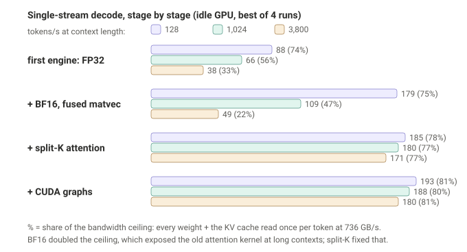
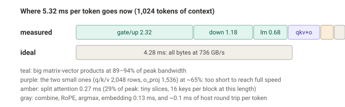
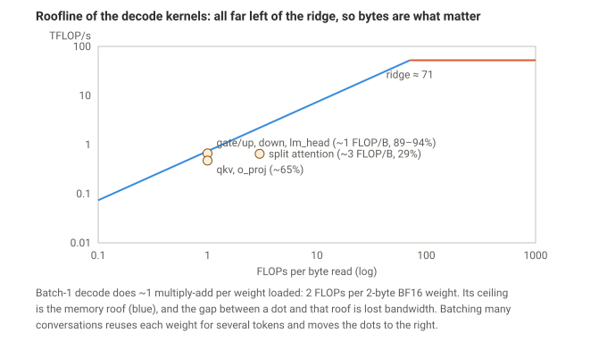

# Single-stream decode performance

How fast Murmur generates one conversation's tokens, how close that is to what the hardware allows, and where the remaining time goes. This is the BF16 baseline; [serving_performance.md](serving_performance.md), [quantization.md](quantization.md) and [comparison.md](comparison.md) build on it.

**Setup.** RTX 4080 SUPER (Ada, 80 SMs, 736 GB/s peak memory bandwidth), driver 616.56, CUDA 13.4, Windows 11, Release build. Model: Qwen2.5-1.5B-Instruct, BF16 weights (3.09 GB) with FP32 activations and an FP32 KV cache. Numbers are from `murmur-lab decode`: greedy decoding after a prompt of the stated length, best of 4 runs of 32 steps, on an otherwise idle GPU.

## The ceiling

Generating one token reads every weight once and every cached key and value once. Nothing can make that faster than

```
time per token >= (weight bytes + KV-cache bytes) / peak bandwidth
```

At 1,024 tokens of context that is (3.09 GB + 58 MB) / 736 GB/s = 4.28 ms, or 234 tokens/s. Results below are reported as a share of this ceiling.

## Results, stage by stage



| Stage | 128 tokens | 1,024 tokens | 3,800 tokens |
| --- | --- | --- | --- |
| FP32 weights, cuBLAS, one attention block per head | 88 t/s (74%) | 66 t/s (56%) | 38 t/s (33%) |
| + BF16 weights, fused matrix-vector kernels | 179 t/s (75%) | 109 t/s (47%) | 49 t/s (22%) |
| + split-K decode attention | 185 t/s (78%) | 180 t/s (77%) | 171 t/s (77%) |
| + CUDA Graphs | **193 t/s (81%)** | **188 t/s (80%)** | **180 t/s (81%)** |

1. **BF16 weights.** The checkpoint is BF16; keeping it that way halves the bytes per token. Weights are widened to FP32 in registers, so results are unchanged (every reference check still passes).
2. **Matrix-vector kernel with fusion.** One-token decode is y = W·x per layer, about one multiply-add per weight loaded, so the kernel streams weights with 16-byte loads and several loads in flight per lane. RMSNorm runs as a prologue; bias, residual add and SwiGLU run as epilogues; q/k/v and gate/up weights are stacked. A decode layer went from 20 launches to 6.
3. **Split-K attention.** The FP32 version used one block per query head (12 blocks for 80 SMs). Decode attention now splits the context over up to 128 blocks per KV head, reads each key and value once for the 6 query heads sharing it, and merges slices with exact online-softmax rescaling. Halving the weight bytes had made the old kernel the bottleneck at long contexts.
4. **CUDA Graphs.** Each decode step (~200 kernels) is recorded once and replayed with a single launch; the token, position and context length are read from GPU memory, filled from pinned host memory by the graph's first copy.

## Where the time goes now



Median kernel times from Nsight Systems at 1,024 tokens of context, per token:

| Work | Bytes per token | Time | Bandwidth | % of peak |
| --- | --- | --- | --- | --- |
| RMSNorm + gate/up + SwiGLU (28×) | 1,541 MB | 2.32 ms | 663 GB/s | 90% |
| down + residual (28×) | 771 MB | 1.18 ms | 655 GB/s | 89% |
| RMSNorm + LM head | 467 MB | 0.68 ms | 691 GB/s | 94% |
| RMSNorm + q/k/v + bias (28×) | 176 MB | 0.37 ms | 473 GB/s | 64% |
| o_proj + residual (28×) | 132 MB | 0.27 ms | 481 GB/s | 65% |
| split attention (28×) | 59 MB | 0.27 ms | 216 GB/s | 29% |
| combine, RoPE + cache write, argmax, embedding | — | 0.13 ms | | |
| host round trip (graph launch, argmax result) | — | ~0.1 ms | | |
| **total** | **3.15 GB** | **5.32 ms** | **592 GB/s** | **80%** |



## Explaining the remaining 20%

- **Large matrix-vector products run at 89–94%.** That is close to what streaming kernels reach on this GPU; DRAM refresh, read/write turnarounds and page switches account for most of the rest.
- **The two small products run at ~65%** (6 MB for q/k/v, 4.7 MB for o_proj per layer). Each lasts 10–13 µs, so ramp-up and the tail of the last wave of blocks are a large share of their runtime. Overlapping them with their neighbours (programmatic dependent launch) could save up to ~0.2 ms.
- **Split attention runs at 29% of peak** at this length: slices of 16 keys per block are too small to keep enough bytes in flight. It's 5% of the step at 1,024 tokens. The rebuilt kernel in [comparison.md](comparison.md) uses 64-key slices, and an FP8 KV cache halves its bytes ([quantization.md](quantization.md)).
- **Host time is down to ~0.1 ms per token** thanks to graphs: one graph launch, an argmax readback and the stream synchronization.
- **Sampling is not included above.** These runs decode greedily on the GPU. Sampling with temperature, top-k and top-p on the CPU would add a 600 KB logits copy and a top-k pass over 151,665 candidates per token, about 0.7 ms; the engine samples on the GPU instead ([serving_performance.md](serving_performance.md)).

## Beyond one conversation

Batch-1 decode sits far left of the roofline's ridge (~1 FLOP per byte against a ridge of ~71), so it can only get faster by moving fewer bytes or by reusing each byte for more work. Batching does the latter: many conversations reuse every weight read in the same step ([serving_performance.md](serving_performance.md)). FP8 and INT4 weights do the former ([quantization.md](quantization.md)).

## Reproducing

```
murmur-lab decode                  # 128, 1,024 and 3,800 tokens of context
murmur-lab decode --no-graphs      # without CUDA Graphs
murmur-lab matvec                  # the matrix-vector kernel on each fused product
```

Another program rendering on the same GPU (a game editor, for example) slows these runs down; the benchmarks report the best of several runs for that reason, but measure on an idle GPU for publishable numbers.
