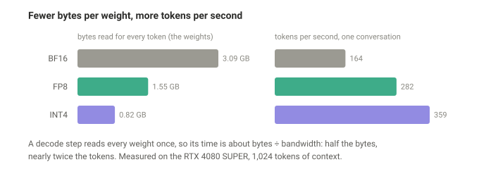
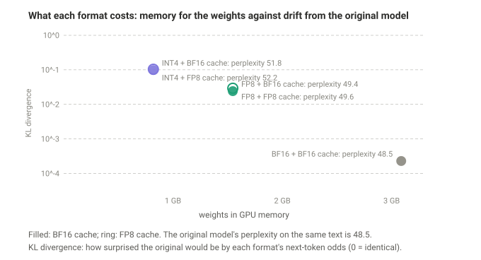
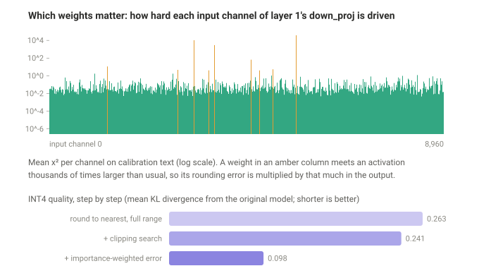
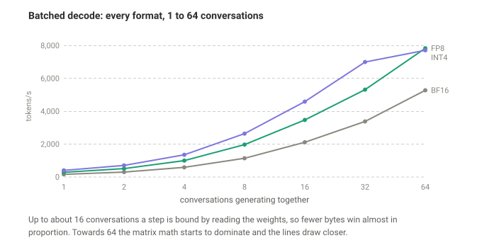
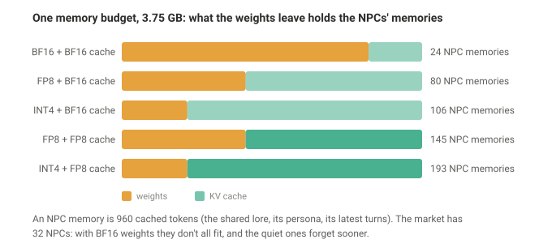
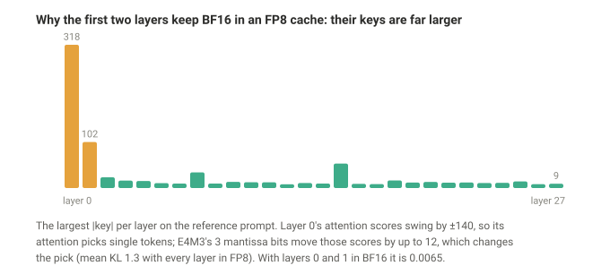

# Weight and KV-cache formats

How much speed, NPC capacity and quality each storage format buys in Murmur, and which one the game uses. The weights can be BF16 (as shipped), FP8 or INT4; the KV cache FP32, BF16 or FP8. Everything is measured on the machine below.

**Setup:** RTX 4080 SUPER (Ada, 80 SMs, 16 GB, 736 GB/s), driver 616.56, CUDA 13.4, Release build, Qwen2.5-1.5B-Instruct. A browser and an editor shared the GPU during the speed runs (10–25% of its SMs), so absolute speeds are a little low; comparisons between formats were measured back to back. Reproduce with `murmur-lab calibrate`, `murmur-lab quality` and `python docs/diagrams/measure_quant_speed.py`.

## The formats

| | Bytes per weight | Scale | Read by |
| --- | --- | --- | --- |
| BF16 | 2 | none | `MatVec`; cuBLAS or `GemmF16` for several rows |
| FP8 (E4M3) | 1 | one FP32 per output row (largest weight → 448) | `MatVec`; `GemmF16`, or FP8 tensor cores via cuBLASLt for prompt chunks |
| INT4 | 0.5 + 4 bytes per 128 | an FP16 scale and minimum per group of 128 weights; the range clipped and steered by channel importance | `MatVec`; `GemmF16` |

The checkpoint stays BF16 on disk. `ModelWeights::Upload` converts every matrix on the GPU while loading (about two seconds), embedding table included. INT4 uses the model's channel importance (`importance.bin`, made once by `murmur-lab calibrate` from 80 market dialogues, 33,600 tokens) when it exists.

## Quality

`murmur-lab quality` runs the original model (BF16 weights, FP32 KV cache, exact FP32 matrix products) and every candidate over the same text, and compares their next-token distributions at every position: 9,386 tokens of prose (a frozen excerpt of these docs, [reference/eval/prose.txt](../reference/eval/prose.txt)) and 16 market dialogues (NPCs and questions disjoint from calibration), 15,898 positions in all.

| Weights | KV cache | Prompt rows on | Mean KL | p99 KL | Same top token | Perplexity, prose | Perplexity, dialogue |
| --- | --- | --- | --- | --- | --- | --- | --- |
| BF16 | FP32 | exact FP32 (the reference) | 0 | 0 | 100% | 48.48 | 23.63 |
| BF16 | FP32 | cuBLAS, x in BF16 | 0.00005 | 0.0003 | 99.7% | 48.49 | 23.63 |
| BF16 | FP32 | `GemmF16`, x in FP16 | 0.000003 | 0.00003 | 100.0% | 48.48 | 23.62 |
| FP8 | FP32 | exact FP32 | 0.0144 | 0.054 | 91.9% | 48.90 | 23.98 |
| FP8 | FP32 | FP8 tensor cores | 0.0243 | 0.107 | 89.6% | 49.33 | 24.17 |
| INT4 | FP32 | exact FP32 | 0.0979 | 0.527 | 81.1% | 51.76 | 25.51 |
| BF16 | BF16 | exact FP32 | 0.0002 | 0.002 | 99.6% | 48.48 | 23.63 |
| BF16 | FP8 | exact FP32 | 0.0065 | 0.055 | 95.0% | 48.78 | 23.83 |
| **BF16** | **BF16** | **as served** | 0.0002 | 0.002 | 99.4% | 48.49 | 23.65 |
| **FP8** | **BF16** | **as served** | 0.0242 | 0.112 | 89.6% | 49.35 | 24.12 |
| **INT4** | **BF16** | **as served** | 0.0983 | 0.532 | 81.1% | 51.76 | 25.49 |
| FP8 | FP8 | as served | 0.0293 | 0.140 | 89.0% | 49.63 | 24.04 |
| INT4 | FP8 | as served | 0.1045 | 0.553 | 80.3% | 52.19 | 25.64 |

"As served" is the default multi-row math: `GemmF16` for up to 48 rows, the format's fastest path for longer prompt chunks (cuBLAS for BF16, FP8 tensor cores for FP8). The quality runs feed 512-token windows, so they measure the prompt path; decode always multiplies one row at a time in FP32.

- **FP8 weights** cost 0.9% perplexity on their own, 1.8% once prompt rows run on FP8 tensor cores.
- **INT4** started at 24% worse perplexity with plain round-to-nearest. A clipping search per group lowered the mean KL by 8% but left the perplexity at 24%, and weighting the error by channel importance brought it to 6.8%. Most of the gain comes from importance: a handful of input channels in the early layers' down projections are driven millions of times harder than the rest.

  

- **Identical replies** are a harsh test: one early word changes everything after it. Greedy replies to the 16 dialogues share their first 28 tokens on average with BF16 tensor cores, 10 with FP8 and 1 with INT4. Reading them, FP8's replies are as good as the original's; INT4's are in character but drift more.

## Speed

Single-stream decode (1,024 tokens of context) and batched decode (512 tokens of context each):

| Conversations | BF16 tokens/s | FP8 | INT4 |
| --- | --- | --- | --- |
| 1 (decode benchmark) | 164 | 282 | 359 |
| 2 | 301 | 513 | 707 |
| 4 | 590 | 1,001 | 1,353 |
| 8 | 1,143 | 1,975 | 2,642 |
| 16 | 2,117 | 3,476 | 4,589 |
| 32 | 3,382 | 5,321 | 7,003 |
| 64 | 5,279 | 7,838 | 7,716 |
| Prefill, one 512-token chunk | 36.5 ms | 28.9 ms | 38.7 ms |

- **Up to about 16 conversations** a step is bound by reading the weights, and the formats scale almost with their bytes: FP8 1.6–1.7×, INT4 2.2×.
- **At 64** the products are bound by math. Ada's GeForce tensor cores run FP16 with FP32 sums at half rate, and every format ends up near 8 ms per step. FP8 tensor cores (twice the FP16 rate) win there.
- **One INT4 row reaches 62% of the bandwidth ceiling**; BF16 and FP8 reach about 85% and 76%. Each INT4 weight needs more instructions to unpack, and the small matrices (the 2,048-row QKV, the 1,536-row output projection) are bound by latency, not bytes. Giving narrow formats more rows per warp raised INT4 from 46%.
- **Prefill** is bound by math, so INT4 doesn't help it: its weights are unpacked once per 128 rows (raised from 64, which took INT4 from 44.6 to 38.7 ms). FP8 tensor cores are the fastest prompt path.

## The market

`murmur-lab market --seconds 60` (30 NPCs talking non-stop, the player asking every 2 s), BF16 KV cache of 1 GB:

| | BF16 | FP8 | INT4 |
| --- | --- | --- | --- |
| Tokens/s | 1,289 | 1,673 | 1,136 |
| Player time to first token, p50 / p99 | 18 / 38 ms | 15 / 32 ms | 21 / 42 ms |

Market steps mix 30 decode rows with prompt chunks of up to 256 tokens (the NPCs forget and recompute old turns), so prompt speed counts as much as decode speed. That puts INT4 behind BF16 here. The formats also generate different text, so the amount of recomputing differs a little between runs.

## Capacity

The game reserves 3.75 GB for the model; the KV cache gets what the weights leave. An NPC's memory is 960 tokens.

| Weights + cache | KV cache | Pages (16 tokens) | NPC memories |
| --- | --- | --- | --- |
| BF16 + BF16 | 0.67 GB | 1,461 | 24 |
| FP8 + BF16 | 2.21 GB | 4,819 | 80 |
| INT4 + BF16 | 2.94 GB | 6,403 | 106 |
| FP8 + FP8 | 2.21 GB | 8,758 | 145 |
| INT4 + FP8 | 2.94 GB | 11,637 | 193 |

The X-ray in the game (Tab) shows the split as a bar and the cache as a page map whose squares shrink to fit. Q cycles the weights and K the cache while the market talks.

## The KV cache

- **BF16** halves the FP32 cache at no measurable cost (mean KL 0.0002) and is the default.
- **FP8** with one scale per token and head: with every layer in FP8, mean KL was 1.4 and perplexity 3.8× worse (183 against 48.5 on prose). The first two layers' keys reach 318 and 102 (the others stay under 25); layer 0's attention scores spread over ±140, so its attention picks single tokens, and FP8's 3 mantissa bits moved those scores by up to 12. Keeping layers 0 and 1 in BF16 (7% more bytes) gives mean KL 0.0065.

## What didn't work

- **Plain round-to-nearest INT4** (24% worse perplexity) and **clipping alone** (24%): see Quality.
- **An FP8 head for INT4 models** (the tied embedding and output projection kept in FP8): mean KL 0.098 → 0.086 for 13% more bytes (0.82 → 0.93 GB). Importance weighting gains more and costs no bytes.
- **FP8 tensor cores for every batch size**: cuBLASLt's FP8 product is slower than `GemmF16` below about 48 rows (434 against 530 tokens/s for 2 conversations), and it is less accurate, so it is used only for prompt chunks.
- **An FP8 KV cache in every layer**: see The KV cache.

## Recommendation

**FP8 weights with a BF16 KV cache**, the game's default:
- decode 1.7× faster than BF16 for one conversation and 1.6× for 16;
- prompts 1.3× faster on FP8 tensor cores;
- 3.3× the NPC memories in the same budget;
- the best market throughput and player latency;
- for 2% perplexity, with replies that read as well as the original's.

**INT4** when memory is what runs out: 106 NPC memories (193 with an FP8 cache), and the fastest single conversation. It costs 7% perplexity, and its prompts are no faster than BF16's, so it loses in a prompt-heavy market.

**An FP8 KV cache** when the cache is the limit: 1.8× the tokens for a small loss (mean KL +0.006). **BF16 weights** stay the reference.

## Possible improvements

- **A better INT4 quantizer**: GPTQ (error compensation across a row) or AWQ (scaling salient channels), and smaller groups (64), to close more of the 7% gap.
- **A faster INT4 tensor-core kernel**: Marlin-style pre-shuffled weights loaded straight into fragment order, larger tiles, and a deeper pipeline, so prompts gain from INT4 too.
- **INT4 matrix-vector for small matrices**: several warps per row or programmatic dependent launch, so the 2,048- and 1,536-row products stop being bound by latency.
- **FP8 activations without the first layers' cost**: per-channel smoothing of the activations' outliers (SmoothQuant), so W8A8 holds FP8's weight-only quality.
