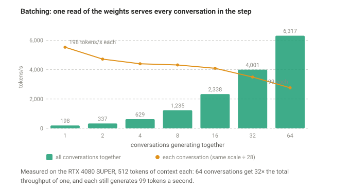
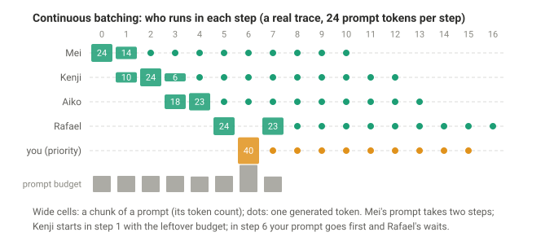
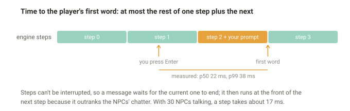
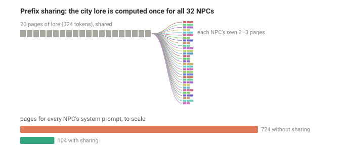
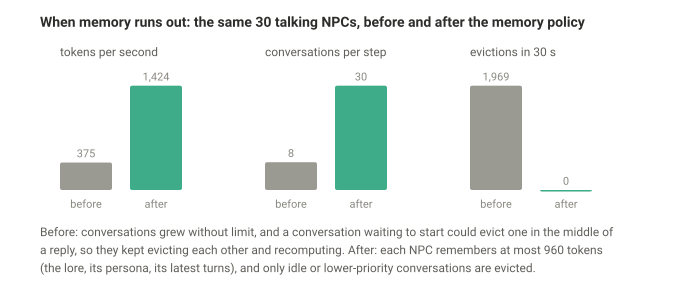

# Serving many conversations

How Murmur runs the market's 32 NPCs on one GPU at once: a paged KV cache with prefix sharing, continuous batching with chunked prefill, tensor-core matrix products for batched rows, sampling on the GPU, and a memory policy for when the cache fills. All numbers are measured on the machine below.

**Setup:** RTX 4080 SUPER (Ada, 80 SMs, 16 GB, 736 GB/s), driver 616.56, CUDA 13.4, Release build, Qwen2.5-1.5B-Instruct with BF16 weights (3.09 GB) and an FP32 KV cache of 1 GB (1,170 pages of 16 tokens).

## Batched decode: throughput against latency

`murmur-lab batch`: B conversations, each with 512 tokens already cached, generate one token per step together. The step time is each conversation's time per token; B divided by it is the total throughput. A step reads every weight once whatever B is, plus every conversation's keys and values, so the ceiling for B tokens is B × 736 GB/s ÷ (weight bytes + B × KV bytes).

| Conversations | ms per step | Tokens/s, all | Tokens/s, each | Ceiling | % of ceiling |
| --- | --- | --- | --- | --- | --- |
| 1 | 5.06 | 198 | 198 | 236 | 84% |
| 2 | 5.93 | 337 | 169 | 467 | 72% |
| 4 | 6.36 | 629 | 157 | 917 | 69% |
| 8 | 6.48 | 1,235 | 154 | 1,765 | 70% |
| 16 | 6.84 | 2,338 | 146 | 3,286 | 71% |
| 32 | 8.00 | 4,001 | 125 | 5,774 | 69% |
| 64 | 10.13 | 6,317 | 99 | 9,292 | 68% |

- **From 1 to 64 conversations** the total throughput grows 32× while each conversation slows by only 2×: every step reads each weight once, however many conversations it serves.
- **One conversation runs at 84%** of its ceiling: a single row uses the custom BF16 matrix-vector kernel ([decode report](decode_performance.md)).
- **Two or more run at about 70%.** Batched rows use cuBLAS's BF16 matrix multiply on tensor cores. For a handful of rows that is a very wide, very short product, and cuBLAS streams the weights less efficiently than the custom kernel does for one row. Batches of up to 48 rows now go through the engine's own tensor-core kernel, `GemmF16`, instead ([quantization.md](quantization.md)).
- **At 64 conversations** the per-conversation keys and values (64 × 540 tokens × 57 KB = 2.0 GB) are two fifths of the bytes per step, and the math starts to count (64 FLOPs per weight byte, close to the ridge at 71). Batching moves decode to the right on the roofline.

## Continuous batching and chunked prefill

Every step the engine plans again which conversations run and how many tokens each: higher priority first; within a priority, decoding conversations before prompts; prompts in arrival order and cut into chunks that fit a per-step budget (256 tokens in the game). `murmur-lab schedule` prints a five-conversation run with a 24-token budget:

Conversations join the batch the step their message arrives and leave the step their reply ends; in step 6 the player's prompt, at a higher priority, runs all 40 of its tokens at once, and Rafael's waits a step.

## The market under load

`murmur-lab market --seconds 600`: 30 NPCs (the game's personas, all starting with the same 324-token city lore) talk non-stop for 10 minutes, each starting a new line as soon as the last ends; the player asks a question every 2 s at higher priority. Another program shared the GPU on and off during the runs, so the tails are, if anything, pessimistic.

| | Result |
| --- | --- |
| Throughput | 1,402 tokens/s |
| Conversations per step | median 30, max 31 |
| Step time | p50 17.1 ms, p99 36.0 ms |
| Player time to first token | p50 22.1 ms, p99 38.4 ms, worst 41.1 ms (298 questions) |
| Evictions | 0 |
| KV-cache pages after closing everything | 1,170 / 1,170 free |

The player's first token arrives within at most the rest of the current step plus the next one, because steps can't be interrupted and the player's prompt runs at the front of the next step:

## Memory

**Prefix sharing.** The 32 NPC system prompts are 349 to 365 tokens each, the first 320 of them the same city lore. Shared full pages put all 32 in 104 pages instead of 724. Pages that no conversation uses stay cached until memory runs short, so a conversation that comes back after an eviction often finds its history still there.

**The memory policy.** The first version of the scheduler let any conversation evict any other of equal priority, and let conversations grow without limit. Under the same 30-NPC load (30 s runs) the cache thrashed:

| | Before | After |
| --- | --- | --- |
| Tokens/s | 375 | 1,424 |
| Conversations per step (median) | 8 | 30 |
| Evictions in 30 s | 1,969 | 0 |
| Player time to first token, p99 | 46.4 ms | 30.5 ms |

Two changes fixed it:
- A conversation waiting to start may only take free memory, idle conversations' pages, or the pages of lower-priority ones; it never evicts an equally important conversation in the middle of a reply. Only a conversation already generating its reply may.
- Each NPC remembers at most 960 tokens: when a new message wouldn't fit, the oldest turns are forgotten and the system prompt is kept (usually straight from the prefix cache).

A one-hour run then found a tail: the player's time to first token reached 402 ms at p99 (over 1,748 questions). The benchmark's player conversation had no memory budget, so every few dozen questions it forgot old turns and recomputed about 1,900 tokens of history at the ordinary 256-token prompt budget per step. Giving the player the same 960-token memory as an NPC (in the game the player talks inside an NPC's conversation), and letting a higher-priority prompt use the whole step, brought the p99 to the 38 ms above.

**Leaks.** The allocator's books are checked three ways:
- a test replays 20,000 random allocate, share, publish, truncate and free operations and checks after every one that each page is owned or free exactly once;
- every engine test ends by freeing all pages and checking;
- the market benchmark ran non-stop for an hour: 201,481 steps and 5.66 million generated tokens, after which all 1,170 pages were free again.

## Correctness

- **The paged, batched engine is checked against the reference.** All 170 checkpoints and the greedy reply still match Hugging Face on the exact FP32 path; batched steps match the same sequences run one at a time to 2 × 10⁻⁴; a shared prefix gives the same logits as computing it.
- **Tensor-core rows round activations to BF16.** At the worst layer the activations drift up to 4.6% from the FP32 reference (relative to the tensor's largest value), and the predicted next token is unchanged on both reference prompts. The reference tests keep the exact path.
- **GPU sampling** picks the same token as the CPU sampler for the same random draw, across greedy, top-k, top-p and repetition-penalty settings.
- compute-sanitizer memcheck, racecheck and synccheck report no errors on the paged attention kernels, the batched forward pass, the sampler and the engine tests. 126 tests pass in Debug and Release.

## Since these measurements

- The KV cache is BF16 by default, with FP8 as an option, and the weights can be FP8 or INT4; [quantization.md](quantization.md) measures both, and FP8 weights are the game's default.
- Batches of 2 to 48 rows use `GemmF16`, the engine's own tensor-core kernel.
- Mixed steps (decode rows plus prompt chunks) still launch every kernel directly; only decode-only steps replay a CUDA graph.
